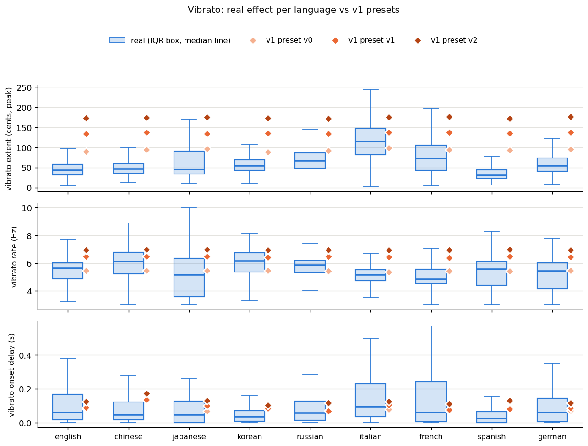
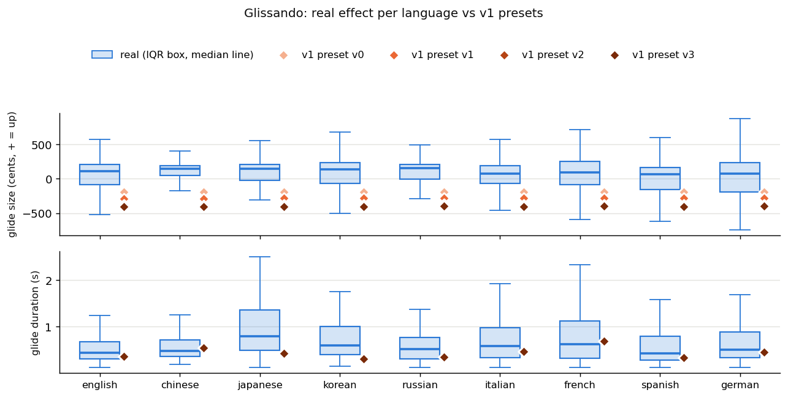
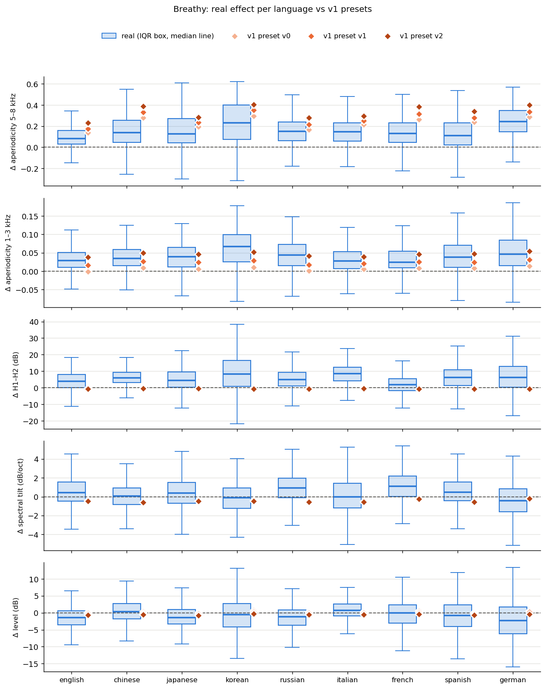
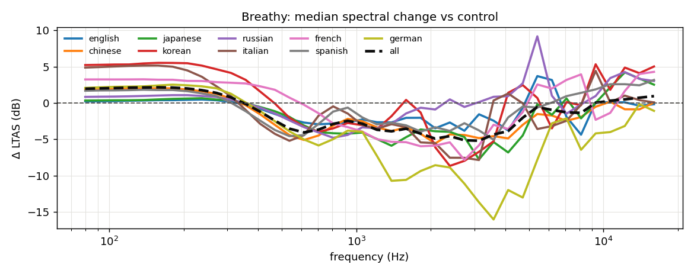
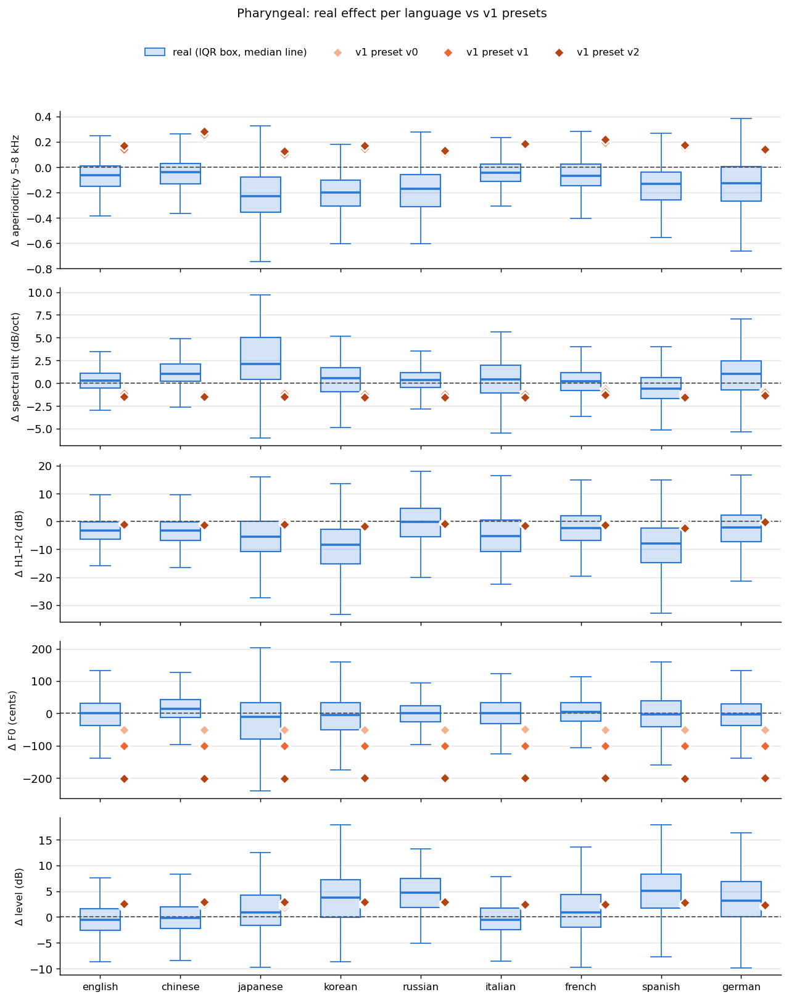
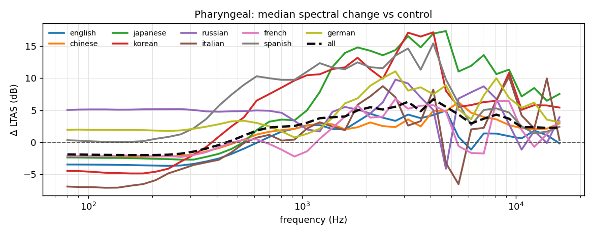
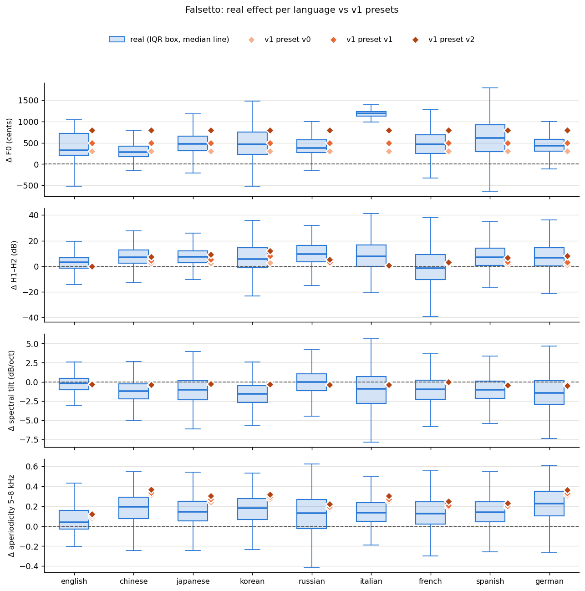
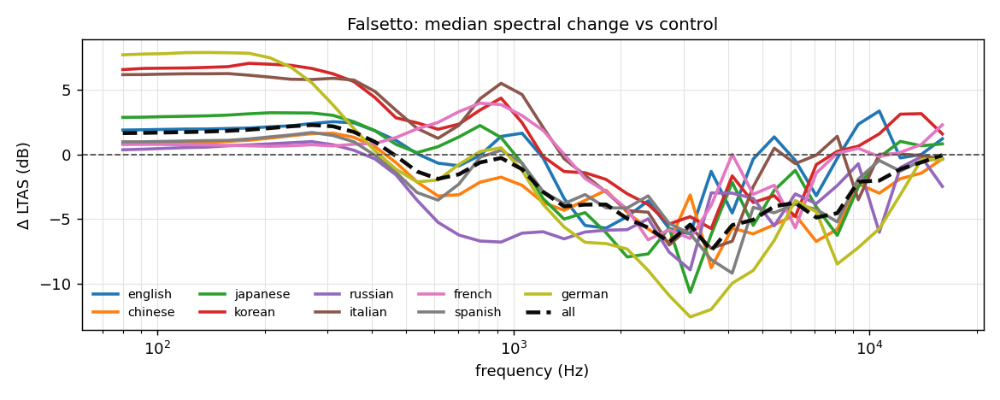
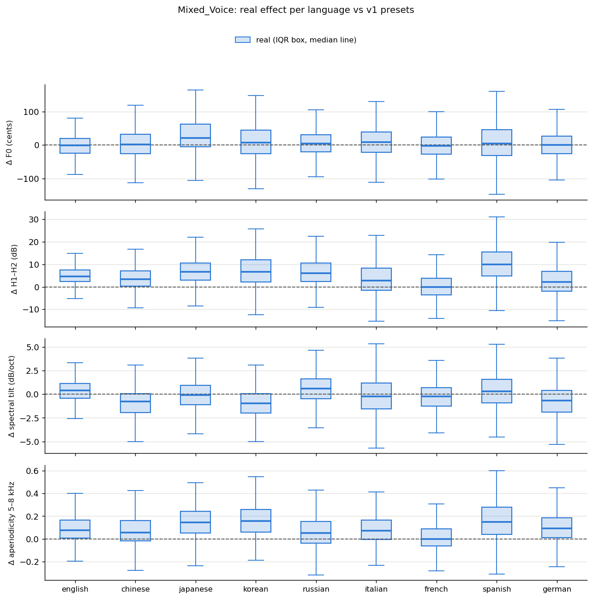
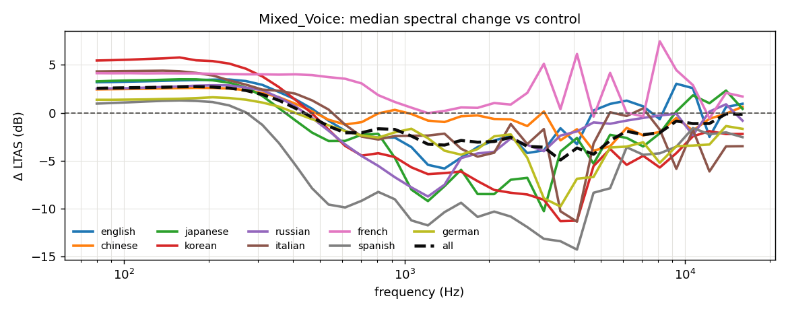

# Technique calibration report

## Headline — v1 preset verdicts (count over languages × presets)

| technique        | feature                      |   too strong |   too weak |   within IQR |   wrong direction |
|:-----------------|:-----------------------------|-------------:|-----------:|-------------:|------------------:|
| Breathy_Group    | Δ H1–H2 (dB)                 |            0 |          0 |            3 |                24 |
| Breathy_Group    | Δ aperiodicity 1–3 kHz       |            0 |          8 |           18 |                 1 |
| Breathy_Group    | Δ aperiodicity 5–8 kHz       |           17 |          0 |           10 |                 0 |
| Breathy_Group    | Δ level (dB)                 |            0 |          0 |           27 |                 0 |
| Breathy_Group    | Δ spectral tilt (dB/oct)     |            4 |          3 |           17 |                 3 |
| Falsetto_Group   | Δ F0 (cents)                 |            8 |          5 |           14 |                 0 |
| Falsetto_Group   | Δ H1–H2 (dB)                 |            0 |          4 |           23 |                 0 |
| Falsetto_Group   | Δ aperiodicity 5–8 kHz       |           12 |          0 |           15 |                 0 |
| Falsetto_Group   | Δ spectral tilt (dB/oct)     |            0 |          3 |           24 |                 0 |
| Glissando_Group  | glide duration (s)           |            0 |          8 |           28 |                 0 |
| Glissando_Group  | glide size (cents, + = up)   |           31 |          0 |            1 |                 4 |
| Pharyngeal_Group | Δ F0 (cents)                 |           25 |          0 |            2 |                 0 |
| Pharyngeal_Group | Δ H1–H2 (dB)                 |            0 |          6 |           21 |                 0 |
| Pharyngeal_Group | Δ aperiodicity 5–8 kHz       |           14 |          1 |            0 |                12 |
| Pharyngeal_Group | Δ level (dB)                 |            9 |          0 |           18 |                 0 |
| Pharyngeal_Group | Δ spectral tilt (dB/oct)     |           15 |          0 |            6 |                 6 |
| Vibrato_Group    | vibrato extent (cents, peak) |           24 |          0 |            3 |                 0 |
| Vibrato_Group    | vibrato onset delay (s)      |           10 |          0 |           17 |                 0 |
| Vibrato_Group    | vibrato rate (Hz)            |           16 |          0 |           11 |                 0 |

Paired design: every technique take is compared with the control take of the same phrase (same singer, same lyrics), phone span by phone span, on train songs only. *Real effect* = technique − control; *v1 effect* = v1 augmentation of the control − control, measured on the same spans.

Verdicts compare the median effect of each v1 preset with the real per-span distribution of that language: **within IQR**, **too weak**, **too strong**, or **wrong direction** (real effect has a clear sign and the preset goes the other way).

## Control contamination

Share of measured spans whose *control* take is already annotated with the same technique (the baseline is not technique-free there).

| group             |   english |   chinese |   japanese |   korean |   russian |   italian |   french |   spanish |   german |
|:------------------|----------:|----------:|-----------:|---------:|----------:|----------:|---------:|----------:|---------:|
| Breathy_Group     |       3.8 |       0   |        0   |      0   |       0   |       0   |      0.1 |       0   |      0   |
| Falsetto_Group    |       0.2 |       0.1 |        0   |      0   |       0   |       4.1 |      0   |       0   |      0   |
| Glissando_Group   |      48.9 |       6.6 |       13.6 |      9.9 |      10.4 |      29.5 |     35.6 |      18.9 |     20.1 |
| Mixed_Voice_Group |       0   |       0   |        0   |      4.6 |       0   |       1.1 |      0.5 |       2.7 |      0   |
| Pharyngeal_Group  |       0   |       0   |        0   |      0   |       0.3 |       0   |      0   |       0   |      0.3 |
| Vibrato_Group     |       0   |       0.4 |        0   |      0   |       0   |       6.1 |      1.9 |       2.4 |      0   |

## Vibrato

| feature                      | language   |   n |   real_q25 |   real_median |   real_q75 |   control_median |   legacy_v0_median |   legacy_v1_median |   legacy_v2_median | legacy_v0_verdict   | legacy_v1_verdict   | legacy_v2_verdict   |
|:-----------------------------|:-----------|----:|-----------:|--------------:|-----------:|-----------------:|-------------------:|-------------------:|-------------------:|:--------------------|:--------------------|:--------------------|
| vibrato extent (cents, peak) | english    | 492 |      31.17 |         42.97 |      57.45 |            18.11 |              89.62 |             134.12 |             172.99 | too strong          | too strong          | too strong          |
| vibrato extent (cents, peak) | chinese    | 782 |      35.06 |         46.12 |      60.44 |            25.46 |              94.41 |             136.97 |             173.55 | too strong          | too strong          | too strong          |
| vibrato extent (cents, peak) | japanese   |  51 |      33.17 |         45.14 |      90.61 |            28.5  |              96.06 |             134.29 |             175.17 | too strong          | too strong          | too strong          |
| vibrato extent (cents, peak) | korean     | 183 |      42.78 |         54.27 |      68.59 |            25.5  |              88.44 |             135.24 |             172.51 | too strong          | too strong          | too strong          |
| vibrato extent (cents, peak) | russian    | 116 |      47.27 |         66.59 |      86.64 |            15.34 |              92.17 |             133.74 |             171.39 | too strong          | too strong          | too strong          |
| vibrato extent (cents, peak) | italian    | 590 |      81.85 |        114.21 |     147.11 |            42.39 |              98.99 |             136.94 |             175.37 | within IQR          | within IQR          | too strong          |
| vibrato extent (cents, peak) | french     | 405 |      43.26 |         71.85 |     106.03 |            30.6  |              94.47 |             136.94 |             175.63 | within IQR          | too strong          | too strong          |
| vibrato extent (cents, peak) | spanish    | 262 |      22    |         29.94 |      44.34 |            23.73 |              92.94 |             135.1  |             171.74 | too strong          | too strong          | too strong          |
| vibrato extent (cents, peak) | german     | 458 |      40.48 |         53.91 |      74    |            33.19 |              94.67 |             137.76 |             176.73 | too strong          | too strong          | too strong          |
| vibrato rate (Hz)            | english    | 492 |       4.88 |          5.62 |       6.01 |             3.78 |               5.47 |               6.49 |               6.93 | within IQR          | too strong          | too strong          |
| vibrato rate (Hz)            | chinese    | 782 |       5.22 |          6.1  |       6.79 |             4.2  |               5.47 |               6.49 |               6.98 | within IQR          | within IQR          | too strong          |
| vibrato rate (Hz)            | japanese   |  51 |       3.59 |          5.18 |       6.35 |             3.91 |               5.47 |               6.49 |               6.98 | within IQR          | too strong          | too strong          |
| vibrato rate (Hz)            | korean     | 183 |       5.37 |          6.15 |       6.74 |             3.86 |               5.47 |               6.42 |               6.93 | within IQR          | within IQR          | too strong          |
| vibrato rate (Hz)            | russian    | 116 |       5.32 |          5.86 |       6.2  |             4.1  |               5.44 |               6.47 |               6.96 | within IQR          | too strong          | too strong          |
| vibrato rate (Hz)            | italian    | 590 |       4.74 |          5.18 |       5.52 |             4.88 |               5.37 |               6.45 |               6.93 | within IQR          | too strong          | too strong          |
| vibrato rate (Hz)            | french     | 405 |       4.54 |          4.83 |       5.57 |             4.3  |               5.42 |               6.4  |               6.93 | within IQR          | too strong          | too strong          |
| vibrato rate (Hz)            | spanish    | 262 |       4.42 |          5.57 |       6.1  |             4.1  |               5.42 |               6.49 |               6.98 | within IQR          | too strong          | too strong          |
| vibrato rate (Hz)            | german     | 458 |       4.15 |          5.42 |       6.01 |             3.83 |               5.47 |               6.45 |               6.93 | within IQR          | too strong          | too strong          |
| vibrato onset delay (s)      | english    | 492 |       0.02 |          0.06 |       0.17 |             0.01 |               0.08 |               0.09 |               0.12 | within IQR          | within IQR          | within IQR          |
| vibrato onset delay (s)      | chinese    | 782 |       0.02 |          0.04 |       0.12 |             0.04 |               0.14 |               0.14 |               0.17 | too strong          | too strong          | too strong          |
| vibrato onset delay (s)      | japanese   |  51 |       0    |          0.04 |       0.13 |             0    |               0.07 |               0.1  |               0.13 | within IQR          | within IQR          | too strong          |
| vibrato onset delay (s)      | korean     | 183 |       0.01 |          0.04 |       0.07 |             0.02 |               0.08 |               0.08 |               0.1  | too strong          | too strong          | too strong          |
| vibrato onset delay (s)      | russian    | 116 |       0.01 |          0.06 |       0.13 |             0    |               0.07 |               0.07 |               0.12 | within IQR          | within IQR          | within IQR          |
| vibrato onset delay (s)      | italian    | 590 |       0.04 |          0.1  |       0.23 |             0.06 |               0.08 |               0.1  |               0.12 | within IQR          | within IQR          | within IQR          |
| vibrato onset delay (s)      | french     | 405 |       0    |          0.06 |       0.24 |             0.01 |               0.07 |               0.08 |               0.11 | within IQR          | within IQR          | within IQR          |
| vibrato onset delay (s)      | spanish    | 262 |       0    |          0.02 |       0.06 |             0.01 |               0.08 |               0.08 |               0.13 | too strong          | too strong          | too strong          |
| vibrato onset delay (s)      | german     | 458 |       0    |          0.06 |       0.14 |             0.02 |               0.07 |               0.08 |               0.12 | within IQR          | within IQR          | within IQR          |

## Glissando

| feature                    | language   |    n |   real_q25 |   real_median |   real_q75 |   control_median |   legacy_v0_median |   legacy_v1_median |   legacy_v2_median |   legacy_v3_median | legacy_v0_verdict   | legacy_v1_verdict   | legacy_v2_verdict   | legacy_v3_verdict   |
|:---------------------------|:-----------|-----:|-----------:|--------------:|-----------:|-----------------:|-------------------:|-------------------:|-------------------:|-------------------:|:--------------------|:--------------------|:--------------------|:--------------------|
| glide size (cents, + = up) | english    |  452 |     -84.62 |        110.93 |     208.35 |            51.31 |            -190.51 |            -284.4  |            -379.3  |            -404.99 | too strong          | too strong          | too strong          | too strong          |
| glide size (cents, + = up) | chinese    | 1279 |      45.88 |        142.99 |     194.17 |             5.94 |            -192.15 |            -287.16 |            -382.26 |            -405.56 | wrong direction     | wrong direction     | wrong direction     | wrong direction     |
| glide size (cents, + = up) | japanese   |   81 |     -23.29 |        149.89 |     208.36 |            -1.24 |            -187.63 |            -282.15 |            -375.59 |            -400.93 | too strong          | too strong          | too strong          | too strong          |
| glide size (cents, + = up) | korean     |  131 |     -63.37 |        138.63 |     235.57 |            -1.19 |            -189.51 |            -283.58 |            -378.2  |            -406.02 | too strong          | too strong          | too strong          | too strong          |
| glide size (cents, + = up) | russian    |  154 |      -2.53 |        152.89 |     206.2  |            -2.82 |            -189.25 |            -282.1  |            -372.37 |            -397.55 | too strong          | too strong          | too strong          | too strong          |
| glide size (cents, + = up) | italian    |  749 |     -67.68 |         78.03 |     194.27 |            -3.4  |            -188.66 |            -282.47 |            -376.63 |            -400.12 | too strong          | too strong          | too strong          | too strong          |
| glide size (cents, + = up) | french     |  590 |     -88.58 |         92.54 |     256    |            11.88 |            -188.94 |            -281.39 |            -375.72 |            -399.31 | too strong          | too strong          | too strong          | too strong          |
| glide size (cents, + = up) | spanish    |  348 |    -152.68 |         66.45 |     161.92 |            -7.22 |            -187.57 |            -282.05 |            -374.17 |            -401.52 | too strong          | too strong          | too strong          | too strong          |
| glide size (cents, + = up) | german     |  292 |    -194.71 |         72.56 |     238.36 |            -8.79 |            -186.68 |            -277.67 |            -373.69 |            -399.03 | within IQR          | too strong          | too strong          | too strong          |
| glide duration (s)         | english    |  456 |       0.3  |          0.44 |       0.68 |             0.38 |               0.36 |               0.36 |               0.36 |               0.36 | within IQR          | within IQR          | within IQR          | within IQR          |
| glide duration (s)         | chinese    | 1280 |       0.36 |          0.48 |       0.72 |             0.44 |               0.55 |               0.55 |               0.55 |               0.55 | within IQR          | within IQR          | within IQR          | within IQR          |
| glide duration (s)         | japanese   |   81 |       0.49 |          0.79 |       1.36 |             0.6  |               0.43 |               0.43 |               0.43 |               0.43 | too weak            | too weak            | too weak            | too weak            |
| glide duration (s)         | korean     |  131 |       0.4  |          0.6  |       1    |             0.29 |               0.31 |               0.31 |               0.31 |               0.31 | too weak            | too weak            | too weak            | too weak            |
| glide duration (s)         | russian    |  154 |       0.31 |          0.52 |       0.77 |             0.34 |               0.35 |               0.35 |               0.35 |               0.35 | within IQR          | within IQR          | within IQR          | within IQR          |
| glide duration (s)         | italian    |  753 |       0.34 |          0.58 |       0.98 |             0.47 |               0.46 |               0.46 |               0.46 |               0.46 | within IQR          | within IQR          | within IQR          | within IQR          |
| glide duration (s)         | french     |  592 |       0.32 |          0.62 |       1.13 |             0.46 |               0.69 |               0.69 |               0.69 |               0.69 | within IQR          | within IQR          | within IQR          | within IQR          |
| glide duration (s)         | spanish    |  349 |       0.28 |          0.43 |       0.8  |             0.35 |               0.34 |               0.34 |               0.34 |               0.34 | within IQR          | within IQR          | within IQR          | within IQR          |
| glide duration (s)         | german     |  293 |       0.34 |          0.51 |       0.89 |             0.38 |               0.45 |               0.45 |               0.45 |               0.45 | within IQR          | within IQR          | within IQR          | within IQR          |

Share of real glides that go **up**: english 67%, chinese 79%, japanese 70%, korean 69%, russian 75%, italian 64%, french 65%, spanish 58%, german 58% (v1 glides are always downward).

## Breathy

| feature                  | language   |    n |   real_q25 |   real_median |   real_q75 |   legacy_v0_median |   legacy_v1_median |   legacy_v2_median | legacy_v0_verdict   | legacy_v1_verdict   | legacy_v2_verdict   |
|:-------------------------|:-----------|-----:|-----------:|--------------:|-----------:|-------------------:|-------------------:|-------------------:|:--------------------|:--------------------|:--------------------|
| Δ aperiodicity 5–8 kHz   | english    | 1033 |       0.03 |          0.08 |       0.16 |               0.14 |               0.18 |               0.23 | within IQR          | too strong          | too strong          |
| Δ aperiodicity 5–8 kHz   | chinese    | 4127 |       0.05 |          0.14 |       0.25 |               0.28 |               0.33 |               0.39 | too strong          | too strong          | too strong          |
| Δ aperiodicity 5–8 kHz   | japanese   |  522 |       0.04 |          0.12 |       0.27 |               0.19 |               0.24 |               0.28 | within IQR          | within IQR          | too strong          |
| Δ aperiodicity 5–8 kHz   | korean     |  511 |       0.08 |          0.23 |       0.4  |               0.29 |               0.35 |               0.4  | within IQR          | within IQR          | too strong          |
| Δ aperiodicity 5–8 kHz   | russian    |  446 |       0.06 |          0.15 |       0.24 |               0.17 |               0.22 |               0.28 | within IQR          | within IQR          | too strong          |
| Δ aperiodicity 5–8 kHz   | italian    | 1043 |       0.06 |          0.15 |       0.23 |               0.21 |               0.25 |               0.3  | within IQR          | too strong          | too strong          |
| Δ aperiodicity 5–8 kHz   | french     |  900 |       0.05 |          0.13 |       0.23 |               0.26 |               0.32 |               0.38 | too strong          | too strong          | too strong          |
| Δ aperiodicity 5–8 kHz   | spanish    | 1359 |       0.02 |          0.11 |       0.23 |               0.24 |               0.28 |               0.34 | too strong          | too strong          | too strong          |
| Δ aperiodicity 5–8 kHz   | german     |  851 |       0.15 |          0.24 |       0.35 |               0.29 |               0.34 |               0.4  | within IQR          | within IQR          | too strong          |
| Δ aperiodicity 1–3 kHz   | english    | 1033 |       0.01 |          0.03 |       0.05 |              -0    |               0.02 |               0.04 | wrong direction     | within IQR          | within IQR          |
| Δ aperiodicity 1–3 kHz   | chinese    | 4127 |       0.01 |          0.03 |       0.06 |               0.01 |               0.03 |               0.05 | too weak            | within IQR          | within IQR          |
| Δ aperiodicity 1–3 kHz   | japanese   |  522 |       0.01 |          0.04 |       0.06 |               0.01 |               0.02 |               0.05 | too weak            | within IQR          | within IQR          |
| Δ aperiodicity 1–3 kHz   | korean     |  511 |       0.03 |          0.07 |       0.1  |               0.01 |               0.03 |               0.05 | too weak            | within IQR          | within IQR          |
| Δ aperiodicity 1–3 kHz   | russian    |  446 |       0.02 |          0.04 |       0.07 |               0    |               0.02 |               0.04 | too weak            | within IQR          | within IQR          |
| Δ aperiodicity 1–3 kHz   | italian    | 1043 |       0.01 |          0.03 |       0.05 |               0.01 |               0.02 |               0.04 | too weak            | within IQR          | within IQR          |
| Δ aperiodicity 1–3 kHz   | french     |  900 |       0.01 |          0.02 |       0.05 |               0.01 |               0.03 |               0.05 | too weak            | within IQR          | within IQR          |
| Δ aperiodicity 1–3 kHz   | spanish    | 1359 |       0.01 |          0.04 |       0.07 |               0.01 |               0.02 |               0.05 | too weak            | within IQR          | within IQR          |
| Δ aperiodicity 1–3 kHz   | german     |  851 |       0.02 |          0.05 |       0.08 |               0.01 |               0.03 |               0.05 | too weak            | within IQR          | within IQR          |
| Δ H1–H2 (dB)             | english    | 1033 |       0.05 |          3.87 |       7.97 |              -0.26 |              -0.54 |              -0.69 | wrong direction     | wrong direction     | wrong direction     |
| Δ H1–H2 (dB)             | chinese    | 4127 |       3.09 |          6.08 |       9.26 |              -0.22 |              -0.24 |              -0.47 | wrong direction     | wrong direction     | wrong direction     |
| Δ H1–H2 (dB)             | japanese   |  522 |       0.4  |          4.34 |       9.44 |              -0.45 |              -0.45 |              -0.54 | wrong direction     | wrong direction     | wrong direction     |
| Δ H1–H2 (dB)             | korean     |  511 |       0.92 |          8.26 |      16.52 |              -1.26 |              -0.97 |              -0.78 | wrong direction     | wrong direction     | wrong direction     |
| Δ H1–H2 (dB)             | russian    |  446 |       1.21 |          4.88 |       9.41 |              -0.52 |              -0.69 |              -0.67 | wrong direction     | wrong direction     | wrong direction     |
| Δ H1–H2 (dB)             | italian    | 1043 |       4.2  |          8.43 |      12.44 |              -0.17 |              -0.32 |              -0.33 | wrong direction     | wrong direction     | wrong direction     |
| Δ H1–H2 (dB)             | french     |  900 |      -1.63 |          1.95 |       5.49 |              -0.84 |              -0.77 |              -0.68 | within IQR          | within IQR          | within IQR          |
| Δ H1–H2 (dB)             | spanish    | 1359 |       1.36 |          6.28 |      10.98 |              -0.56 |              -0.73 |              -0.59 | wrong direction     | wrong direction     | wrong direction     |
| Δ H1–H2 (dB)             | german     |  851 |       0.42 |          6.14 |      12.93 |              -0.97 |              -0.85 |              -0.62 | wrong direction     | wrong direction     | wrong direction     |
| Δ spectral tilt (dB/oct) | english    | 1033 |      -0.46 |          0.44 |       1.54 |              -0.39 |              -0.41 |              -0.47 | within IQR          | within IQR          | too strong          |
| Δ spectral tilt (dB/oct) | chinese    | 4127 |      -0.83 |          0.08 |       0.91 |              -0.56 |              -0.58 |              -0.6  | within IQR          | within IQR          | within IQR          |
| Δ spectral tilt (dB/oct) | japanese   |  522 |      -0.68 |          0.39 |       1.52 |              -0.41 |              -0.43 |              -0.49 | within IQR          | within IQR          | within IQR          |
| Δ spectral tilt (dB/oct) | korean     |  511 |      -1.22 |         -0.09 |       0.91 |              -0.39 |              -0.41 |              -0.46 | within IQR          | within IQR          | within IQR          |
| Δ spectral tilt (dB/oct) | russian    |  446 |      -0.11 |          0.95 |       1.98 |              -0.51 |              -0.53 |              -0.54 | too weak            | too weak            | too weak            |
| Δ spectral tilt (dB/oct) | italian    | 1043 |      -1.18 |         -0    |       1.43 |              -0.5  |              -0.53 |              -0.56 | within IQR          | within IQR          | within IQR          |
| Δ spectral tilt (dB/oct) | french     |  900 |       0.03 |          1.13 |       2.18 |              -0.18 |              -0.21 |              -0.26 | wrong direction     | wrong direction     | wrong direction     |
| Δ spectral tilt (dB/oct) | spanish    | 1359 |      -0.45 |          0.47 |       1.56 |              -0.51 |              -0.53 |              -0.56 | too strong          | too strong          | too strong          |
| Δ spectral tilt (dB/oct) | german     |  851 |      -1.61 |         -0.43 |       0.84 |              -0.14 |              -0.16 |              -0.21 | within IQR          | within IQR          | within IQR          |
| Δ level (dB)             | english    | 1033 |      -3.54 |         -1.4  |       0.53 |               0.2  |              -0.21 |              -0.68 | within IQR          | within IQR          | within IQR          |
| Δ level (dB)             | chinese    | 4127 |      -1.74 |          0.33 |       2.7  |               0.29 |              -0.13 |              -0.59 | within IQR          | within IQR          | within IQR          |
| Δ level (dB)             | japanese   |  522 |      -3.36 |         -1.43 |       1    |               0.1  |              -0.31 |              -0.8  | within IQR          | within IQR          | within IQR          |
| Δ level (dB)             | korean     |  511 |      -4.18 |         -0.51 |       2.76 |               0.66 |               0.19 |              -0.32 | within IQR          | within IQR          | within IQR          |
| Δ level (dB)             | russian    |  446 |      -3.73 |         -1.18 |       0.88 |               0.36 |              -0.05 |              -0.59 | within IQR          | within IQR          | within IQR          |
| Δ level (dB)             | italian    | 1043 |      -0.91 |          0.77 |       2.57 |               0.34 |              -0.05 |              -0.54 | within IQR          | within IQR          | within IQR          |
| Δ level (dB)             | french     |  900 |      -3.1  |          0    |       2.36 |               0.63 |               0.15 |              -0.39 | within IQR          | within IQR          | within IQR          |
| Δ level (dB)             | spanish    | 1359 |      -4.03 |         -0.74 |       2.34 |               0.15 |              -0.25 |              -0.72 | within IQR          | within IQR          | within IQR          |
| Δ level (dB)             | german     |  851 |      -6.19 |         -2.25 |       1.69 |               0.58 |               0.16 |              -0.41 | within IQR          | within IQR          | within IQR          |

## Pharyngeal

| feature                  | language   |    n |   real_q25 |   real_median |   real_q75 |   legacy_v0_median |   legacy_v1_median |   legacy_v2_median | legacy_v0_verdict   | legacy_v1_verdict   | legacy_v2_verdict   |
|:-------------------------|:-----------|-----:|-----------:|--------------:|-----------:|-------------------:|-------------------:|-------------------:|:--------------------|:--------------------|:--------------------|
| Δ aperiodicity 5–8 kHz   | english    | 2154 |      -0.15 |         -0.06 |       0.01 |               0.13 |               0.14 |               0.17 | too strong          | too strong          | too strong          |
| Δ aperiodicity 5–8 kHz   | chinese    | 4057 |      -0.13 |         -0.04 |       0.03 |               0.24 |               0.26 |               0.28 | too strong          | too strong          | too strong          |
| Δ aperiodicity 5–8 kHz   | japanese   |  467 |      -0.36 |         -0.23 |      -0.08 |               0.09 |               0.1  |               0.13 | wrong direction     | wrong direction     | wrong direction     |
| Δ aperiodicity 5–8 kHz   | korean     |  553 |      -0.31 |         -0.2  |      -0.1  |               0.14 |               0.15 |               0.17 | wrong direction     | wrong direction     | wrong direction     |
| Δ aperiodicity 5–8 kHz   | russian    |  361 |      -0.31 |         -0.17 |      -0.06 |               0.1  |               0.11 |               0.13 | wrong direction     | wrong direction     | wrong direction     |
| Δ aperiodicity 5–8 kHz   | italian    |  409 |      -0.11 |         -0.04 |       0.03 |               0.16 |               0.18 |               0.19 | too strong          | too strong          | too strong          |
| Δ aperiodicity 5–8 kHz   | french     |  983 |      -0.15 |         -0.07 |       0.03 |               0.18 |               0.19 |               0.22 | too strong          | too strong          | too strong          |
| Δ aperiodicity 5–8 kHz   | spanish    | 1240 |      -0.26 |         -0.13 |      -0.04 |               0.14 |               0.16 |               0.17 | wrong direction     | wrong direction     | wrong direction     |
| Δ aperiodicity 5–8 kHz   | german     | 1077 |      -0.27 |         -0.13 |       0.01 |               0.11 |               0.13 |               0.14 | too weak            | too strong          | too strong          |
| Δ spectral tilt (dB/oct) | english    | 2154 |      -0.55 |          0.27 |       1.07 |              -0.89 |              -1.16 |              -1.45 | too strong          | too strong          | too strong          |
| Δ spectral tilt (dB/oct) | chinese    | 4057 |       0.19 |          1.04 |       2.08 |              -1.02 |              -1.2  |              -1.5  | wrong direction     | wrong direction     | wrong direction     |
| Δ spectral tilt (dB/oct) | japanese   |  467 |       0.38 |          2.12 |       5    |              -0.86 |              -1.16 |              -1.49 | wrong direction     | wrong direction     | wrong direction     |
| Δ spectral tilt (dB/oct) | korean     |  553 |      -0.93 |          0.53 |       1.73 |              -0.97 |              -1.24 |              -1.55 | too strong          | too strong          | too strong          |
| Δ spectral tilt (dB/oct) | russian    |  361 |      -0.44 |          0.38 |       1.18 |              -0.99 |              -1.22 |              -1.52 | too strong          | too strong          | too strong          |
| Δ spectral tilt (dB/oct) | italian    |  409 |      -1.1  |          0.44 |       1.94 |              -0.92 |              -1.21 |              -1.51 | within IQR          | too strong          | too strong          |
| Δ spectral tilt (dB/oct) | french     |  983 |      -0.78 |          0.2  |       1.16 |              -0.62 |              -0.92 |              -1.27 | within IQR          | too strong          | too strong          |
| Δ spectral tilt (dB/oct) | spanish    | 1240 |      -1.7  |         -0.58 |       0.61 |              -0.99 |              -1.26 |              -1.56 | within IQR          | within IQR          | within IQR          |
| Δ spectral tilt (dB/oct) | german     | 1077 |      -0.74 |          1.01 |       2.42 |              -0.72 |              -1.01 |              -1.33 | within IQR          | too strong          | too strong          |
| Δ H1–H2 (dB)             | english    | 2154 |      -6.46 |         -3.21 |      -0.05 |              -0.37 |              -0.54 |              -1.03 | within IQR          | within IQR          | within IQR          |
| Δ H1–H2 (dB)             | chinese    | 4057 |      -6.77 |         -3.31 |      -0.21 |              -0.61 |              -0.74 |              -1.32 | within IQR          | within IQR          | within IQR          |
| Δ H1–H2 (dB)             | japanese   |  467 |     -10.9  |         -5.41 |       0.15 |               0.03 |              -0.14 |              -1.08 | within IQR          | within IQR          | within IQR          |
| Δ H1–H2 (dB)             | korean     |  553 |     -15.22 |         -8.36 |      -2.86 |              -1    |              -1.48 |              -1.6  | too weak            | too weak            | too weak            |
| Δ H1–H2 (dB)             | russian    |  361 |      -5.47 |         -0.1  |       4.79 |              -0.24 |              -0.44 |              -0.73 | within IQR          | within IQR          | within IQR          |
| Δ H1–H2 (dB)             | italian    |  409 |     -10.73 |         -5.29 |       0.51 |              -0.88 |              -1.28 |              -1.52 | within IQR          | within IQR          | within IQR          |
| Δ H1–H2 (dB)             | french     |  983 |      -6.77 |         -2.36 |       2.03 |              -0.38 |              -0.74 |              -1.36 | within IQR          | within IQR          | within IQR          |
| Δ H1–H2 (dB)             | spanish    | 1240 |     -14.71 |         -7.87 |      -2.48 |              -0.88 |              -1.39 |              -2.29 | too weak            | too weak            | too weak            |
| Δ H1–H2 (dB)             | german     | 1077 |      -7.25 |         -2.21 |       2.33 |              -0.39 |              -0.2  |              -0.12 | within IQR          | within IQR          | within IQR          |
| Δ F0 (cents)             | english    | 2154 |     -36.4  |          0.13 |      31.25 |             -50.18 |            -100.33 |            -200.52 | too strong          | too strong          | too strong          |
| Δ F0 (cents)             | chinese    | 4057 |     -13.26 |         13.93 |      42.73 |             -50.76 |            -100.99 |            -201.08 | too strong          | too strong          | too strong          |
| Δ F0 (cents)             | japanese   |  467 |     -79.42 |        -10.68 |      34.02 |             -50.06 |            -100.2  |            -200.58 | within IQR          | too strong          | too strong          |
| Δ F0 (cents)             | korean     |  553 |     -51.02 |         -4.63 |      33.35 |             -49.8  |             -99.81 |            -199.9  | within IQR          | too strong          | too strong          |
| Δ F0 (cents)             | russian    |  361 |     -25.05 |          1.76 |      24.57 |             -49.79 |            -100.02 |            -200.01 | too strong          | too strong          | too strong          |
| Δ F0 (cents)             | italian    |  409 |     -30.67 |          1.52 |      34.02 |             -49.12 |             -99.29 |            -199.21 | too strong          | too strong          | too strong          |
| Δ F0 (cents)             | french     |  983 |     -23.84 |          4.1  |      33.46 |             -50.1  |            -100.05 |            -200.19 | too strong          | too strong          | too strong          |
| Δ F0 (cents)             | spanish    | 1240 |     -40.41 |         -2.67 |      39.66 |             -50.22 |            -100.25 |            -200.5  | too strong          | too strong          | too strong          |
| Δ F0 (cents)             | german     | 1077 |     -37.19 |         -2.17 |      30.4  |             -50.02 |            -100.15 |            -199.91 | too strong          | too strong          | too strong          |
| Δ level (dB)             | english    | 2154 |      -2.54 |         -0.51 |       1.56 |               1.82 |               2.26 |               2.57 | too strong          | too strong          | too strong          |
| Δ level (dB)             | chinese    | 4057 |      -2.23 |         -0.24 |       1.99 |               1.99 |               2.48 |               2.88 | too strong          | too strong          | too strong          |
| Δ level (dB)             | japanese   |  467 |      -1.58 |          0.9  |       4.26 |               1.87 |               2.47 |               2.95 | within IQR          | within IQR          | within IQR          |
| Δ level (dB)             | korean     |  553 |      -0.03 |          3.7  |       7.26 |               2.09 |               2.55 |               2.98 | within IQR          | within IQR          | within IQR          |
| Δ level (dB)             | russian    |  361 |       1.84 |          4.73 |       7.49 |               2.13 |               2.54 |               2.88 | within IQR          | within IQR          | within IQR          |
| Δ level (dB)             | italian    |  409 |      -2.46 |         -0.56 |       1.68 |               1.85 |               2.16 |               2.4  | too strong          | too strong          | too strong          |
| Δ level (dB)             | french     |  983 |      -2.03 |          0.93 |       4.3  |               1.91 |               2.26 |               2.48 | within IQR          | within IQR          | within IQR          |
| Δ level (dB)             | spanish    | 1240 |       1.77 |          5.11 |       8.3  |               2.03 |               2.56 |               2.85 | within IQR          | within IQR          | within IQR          |
| Δ level (dB)             | german     | 1077 |       0.11 |          3.21 |       6.81 |               1.86 |               2.12 |               2.27 | within IQR          | within IQR          | within IQR          |

## Falsetto

| feature                  | language   |    n |   real_q25 |   real_median |   real_q75 |   legacy_v0_median |   legacy_v1_median |   legacy_v2_median | legacy_v0_verdict   | legacy_v1_verdict   | legacy_v2_verdict   |
|:-------------------------|:-----------|-----:|-----------:|--------------:|-----------:|-------------------:|-------------------:|-------------------:|:--------------------|:--------------------|:--------------------|
| Δ F0 (cents)             | english    | 1008 |     207.11 |        328.87 |     718.07 |             299.53 |             499.32 |             798.92 | within IQR          | within IQR          | too strong          |
| Δ F0 (cents)             | chinese    | 9127 |     170.25 |        286.88 |     416.11 |             299.13 |             498.59 |             798.3  | within IQR          | too strong          | too strong          |
| Δ F0 (cents)             | japanese   | 1783 |     309.43 |        478.61 |     659.7  |             299.58 |             499.36 |             798.84 | too weak            | within IQR          | too strong          |
| Δ F0 (cents)             | korean     |  522 |     227.49 |        465.16 |     748.18 |             299.71 |             499.28 |             799.47 | within IQR          | within IQR          | too strong          |
| Δ F0 (cents)             | russian    |  821 |     271.94 |        382.98 |     573.06 |             300.02 |             499.76 |             799.33 | within IQR          | within IQR          | too strong          |
| Δ F0 (cents)             | italian    | 1290 |    1123.11 |       1188.96 |    1231.02 |             300.19 |             500.02 |             799.8  | too weak            | too weak            | too weak            |
| Δ F0 (cents)             | french     | 1215 |     254.33 |        466.09 |     691.59 |             299.57 |             499.31 |             798.85 | within IQR          | within IQR          | too strong          |
| Δ F0 (cents)             | spanish    | 2361 |     290.13 |        608.57 |     924.31 |             299.09 |             499.14 |             798.17 | within IQR          | within IQR          | within IQR          |
| Δ F0 (cents)             | german     | 2281 |     300.52 |        430.24 |     581.28 |             300.11 |             500.41 |             799.88 | too weak            | within IQR          | too strong          |
| Δ H1–H2 (dB)             | english    | 1008 |      -1.58 |          3.01 |       6.84 |               0.05 |              -0.37 |              -0.2  | within IQR          | within IQR          | within IQR          |
| Δ H1–H2 (dB)             | chinese    | 9127 |       2.56 |          7.06 |      12.6  |               2.46 |               4.72 |               7.41 | too weak            | within IQR          | within IQR          |
| Δ H1–H2 (dB)             | japanese   | 1783 |       2.84 |          7.58 |      12.13 |               2.39 |               5.38 |               9.2  | too weak            | within IQR          | within IQR          |
| Δ H1–H2 (dB)             | korean     |  522 |      -1    |          5.58 |      14.6  |               2.93 |               8.26 |              12.01 | within IQR          | within IQR          | within IQR          |
| Δ H1–H2 (dB)             | russian    |  821 |       3.54 |          9.42 |      16.19 |               1.68 |               3.07 |               5.24 | too weak            | too weak            | within IQR          |
| Δ H1–H2 (dB)             | italian    | 1290 |       0.04 |          7.69 |      16.78 |               0.26 |               0.34 |               0.5  | within IQR          | within IQR          | within IQR          |
| Δ H1–H2 (dB)             | french     | 1215 |     -10.21 |         -1.63 |       9.24 |               1.59 |               2.7  |               3.14 | within IQR          | within IQR          | within IQR          |
| Δ H1–H2 (dB)             | spanish    | 2361 |       0.53 |          7.07 |      14.19 |               1.82 |               3.54 |               6.71 | within IQR          | within IQR          | within IQR          |
| Δ H1–H2 (dB)             | german     | 2281 |       0.21 |          6.59 |      14.66 |               1.04 |               3.14 |               8.13 | within IQR          | within IQR          | within IQR          |
| Δ spectral tilt (dB/oct) | english    | 1008 |      -1.01 |         -0.19 |       0.46 |              -0.24 |              -0.25 |              -0.31 | within IQR          | within IQR          | within IQR          |
| Δ spectral tilt (dB/oct) | chinese    | 9127 |      -2.23 |         -1.21 |      -0.27 |              -0.5  |              -0.4  |              -0.39 | within IQR          | within IQR          | within IQR          |
| Δ spectral tilt (dB/oct) | japanese   | 1783 |      -2.37 |         -1.04 |       0.17 |              -0.33 |              -0.29 |              -0.28 | within IQR          | within IQR          | within IQR          |
| Δ spectral tilt (dB/oct) | korean     |  522 |      -2.7  |         -1.6  |      -0.52 |              -0.29 |              -0.34 |              -0.33 | too weak            | too weak            | too weak            |
| Δ spectral tilt (dB/oct) | russian    |  821 |      -1.15 |         -0.02 |       1.07 |              -0.38 |              -0.31 |              -0.4  | within IQR          | within IQR          | within IQR          |
| Δ spectral tilt (dB/oct) | italian    | 1290 |      -2.79 |         -0.9  |       0.67 |              -0.33 |              -0.31 |              -0.36 | within IQR          | within IQR          | within IQR          |
| Δ spectral tilt (dB/oct) | french     | 1215 |      -2.27 |         -0.97 |       0.2  |              -0.15 |              -0.09 |              -0.05 | within IQR          | within IQR          | within IQR          |
| Δ spectral tilt (dB/oct) | spanish    | 2361 |      -2.15 |         -1.03 |       0.07 |              -0.48 |              -0.45 |              -0.43 | within IQR          | within IQR          | within IQR          |
| Δ spectral tilt (dB/oct) | german     | 2281 |      -2.92 |         -1.46 |       0.12 |              -0.26 |              -0.26 |              -0.48 | within IQR          | within IQR          | within IQR          |
| Δ aperiodicity 5–8 kHz   | english    | 1008 |      -0.03 |          0.04 |       0.16 |               0.08 |               0.1  |               0.12 | within IQR          | within IQR          | within IQR          |
| Δ aperiodicity 5–8 kHz   | chinese    | 9127 |       0.08 |          0.19 |       0.29 |               0.31 |               0.34 |               0.37 | too strong          | too strong          | too strong          |
| Δ aperiodicity 5–8 kHz   | japanese   | 1783 |       0.05 |          0.14 |       0.25 |               0.24 |               0.27 |               0.3  | within IQR          | too strong          | too strong          |
| Δ aperiodicity 5–8 kHz   | korean     |  522 |       0.06 |          0.18 |       0.27 |               0.27 |               0.29 |               0.32 | within IQR          | too strong          | too strong          |
| Δ aperiodicity 5–8 kHz   | russian    |  821 |      -0.03 |          0.13 |       0.27 |               0.18 |               0.19 |               0.22 | within IQR          | within IQR          | within IQR          |
| Δ aperiodicity 5–8 kHz   | italian    | 1290 |       0.05 |          0.13 |       0.23 |               0.25 |               0.27 |               0.3  | too strong          | too strong          | too strong          |
| Δ aperiodicity 5–8 kHz   | french     | 1215 |       0.02 |          0.13 |       0.24 |               0.19 |               0.21 |               0.25 | within IQR          | within IQR          | too strong          |
| Δ aperiodicity 5–8 kHz   | spanish    | 2361 |       0.04 |          0.14 |       0.24 |               0.19 |               0.2  |               0.23 | within IQR          | within IQR          | within IQR          |
| Δ aperiodicity 5–8 kHz   | german     | 2281 |       0.1  |          0.23 |       0.35 |               0.31 |               0.33 |               0.36 | within IQR          | within IQR          | too strong          |

## Mixed_Voice

| feature                  | language   |    n |   real_q25 |   real_median |   real_q75 |
|:-------------------------|:-----------|-----:|-----------:|--------------:|-----------:|
| Δ F0 (cents)             | english    | 1040 |     -24.2  |         -1.22 |      19.11 |
| Δ F0 (cents)             | chinese    | 9523 |     -26.34 |          2.01 |      31.82 |
| Δ F0 (cents)             | japanese   | 2066 |      -5.57 |         21.38 |      62.81 |
| Δ F0 (cents)             | korean     |  625 |     -25.74 |          7.8  |      44.65 |
| Δ F0 (cents)             | russian    | 1149 |     -20.6  |          4.21 |      30.05 |
| Δ F0 (cents)             | italian    | 1225 |     -21.69 |          8.63 |      39.52 |
| Δ F0 (cents)             | french     | 1441 |     -27.09 |         -2.32 |      23.88 |
| Δ F0 (cents)             | spanish    | 2675 |     -32.1  |          3.85 |      45.49 |
| Δ F0 (cents)             | german     | 2889 |     -26.56 |          0.68 |      26.94 |
| Δ H1–H2 (dB)             | english    | 1040 |       2.32 |          4.66 |       7.44 |
| Δ H1–H2 (dB)             | chinese    | 9523 |       0.42 |          3.44 |       6.98 |
| Δ H1–H2 (dB)             | japanese   | 2066 |       2.9  |          6.58 |      10.6  |
| Δ H1–H2 (dB)             | korean     |  625 |       2.09 |          6.56 |      11.97 |
| Δ H1–H2 (dB)             | russian    | 1149 |       2.45 |          6.08 |      10.46 |
| Δ H1–H2 (dB)             | italian    | 1225 |      -1.54 |          2.74 |       8.32 |
| Δ H1–H2 (dB)             | french     | 1441 |      -3.53 |         -0.03 |       3.7  |
| Δ H1–H2 (dB)             | spanish    | 2675 |       4.9  |         10.03 |      15.52 |
| Δ H1–H2 (dB)             | german     | 2889 |      -1.94 |          2.08 |       6.77 |
| Δ spectral tilt (dB/oct) | english    | 1040 |      -0.41 |          0.39 |       1.12 |
| Δ spectral tilt (dB/oct) | chinese    | 9523 |      -1.96 |         -0.78 |       0.07 |
| Δ spectral tilt (dB/oct) | japanese   | 2066 |      -1.13 |         -0.08 |       0.92 |
| Δ spectral tilt (dB/oct) | korean     |  625 |      -1.99 |         -0.96 |       0.04 |
| Δ spectral tilt (dB/oct) | russian    | 1149 |      -0.45 |          0.62 |       1.64 |
| Δ spectral tilt (dB/oct) | italian    | 1225 |      -1.57 |         -0.24 |       1.2  |
| Δ spectral tilt (dB/oct) | french     | 1441 |      -1.28 |         -0.25 |       0.7  |
| Δ spectral tilt (dB/oct) | spanish    | 2675 |      -0.89 |          0.29 |       1.58 |
| Δ spectral tilt (dB/oct) | german     | 2889 |      -1.88 |         -0.69 |       0.41 |
| Δ aperiodicity 5–8 kHz   | english    | 1040 |       0.01 |          0.07 |       0.16 |
| Δ aperiodicity 5–8 kHz   | chinese    | 9523 |      -0.02 |          0.06 |       0.16 |
| Δ aperiodicity 5–8 kHz   | japanese   | 2066 |       0.05 |          0.14 |       0.24 |
| Δ aperiodicity 5–8 kHz   | korean     |  625 |       0.06 |          0.16 |       0.26 |
| Δ aperiodicity 5–8 kHz   | russian    | 1149 |      -0.04 |          0.05 |       0.15 |
| Δ aperiodicity 5–8 kHz   | italian    | 1225 |      -0    |          0.07 |       0.17 |
| Δ aperiodicity 5–8 kHz   | french     | 1441 |      -0.06 |         -0    |       0.09 |
| Δ aperiodicity 5–8 kHz   | spanish    | 2675 |       0.04 |          0.15 |       0.28 |
| Δ aperiodicity 5–8 kHz   | german     | 2889 |       0.01 |          0.09 |       0.19 |

### Falsetto: Δ F0 (cents) by voice type

Median per voice × language — the F0 change is a property of the voice type (falsetto register), so the v2 engine uses these.

| voice   |   english |   chinese |   japanese |   korean |   russian |   italian |   french |   spanish |   german |
|:--------|----------:|----------:|-----------:|---------:|----------:|----------:|---------:|----------:|---------:|
| alto    |       329 |       165 |        nan |      nan |       383 |       nan |      nan |       nan |      nan |
| bass    |       nan |       nan |        nan |      nan |       nan |      1202 |      nan |       861 |      nan |
| soprano |       nan |       nan |        336 |      276 |       nan |       -12 |      319 |       260 |      334 |
| tenor   |       nan |       406 |        710 |      698 |       nan |       nan |      730 |       nan |      483 |

### Mixed_Voice: Δ F0 (cents) by voice type

Median per voice × language — the F0 change is a property of the voice type (falsetto register), so the v2 engine uses these.

| voice   |   english |   chinese |   japanese |   korean |   russian |   italian |   french |   spanish |   german |
|:--------|----------:|----------:|-----------:|---------:|----------:|----------:|---------:|----------:|---------:|
| alto    |        -1 |         0 |        nan |      nan |         4 |       nan |      nan |       nan |      nan |
| bass    |       nan |       nan |        nan |      nan |       nan |        15 |      nan |         9 |      nan |
| soprano |       nan |       nan |         11 |        2 |       nan |       -14 |        1 |         0 |        2 |
| tenor   |       nan |         4 |         58 |       13 |       nan |       nan |      -10 |       nan |       -0 |
