# Distribution analysis — real vs augmented techniques

Real effects: all train songs (calibration). Engine effects: the pilot pairs, measured on the same phone spans (technique − control for voice-quality features; the gesture itself for vibrato / glissando).
Engines: **v1** (current presets), **world_v2** / **psola** with the quartile presets (= pilot), and the new per-clip *sampled* modes (`world_v2.sample_presets`): **sampled** draws targets from the whole real distribution (2–98 %), **tails** pushes draws toward both tails.

## A1–A3. Per-language figures

`*_iqr.png` = same style as the vibrato figure (IQR boxes); `*_full.png` = whiskers, every outlier and the real 1–99 % band ("human range").

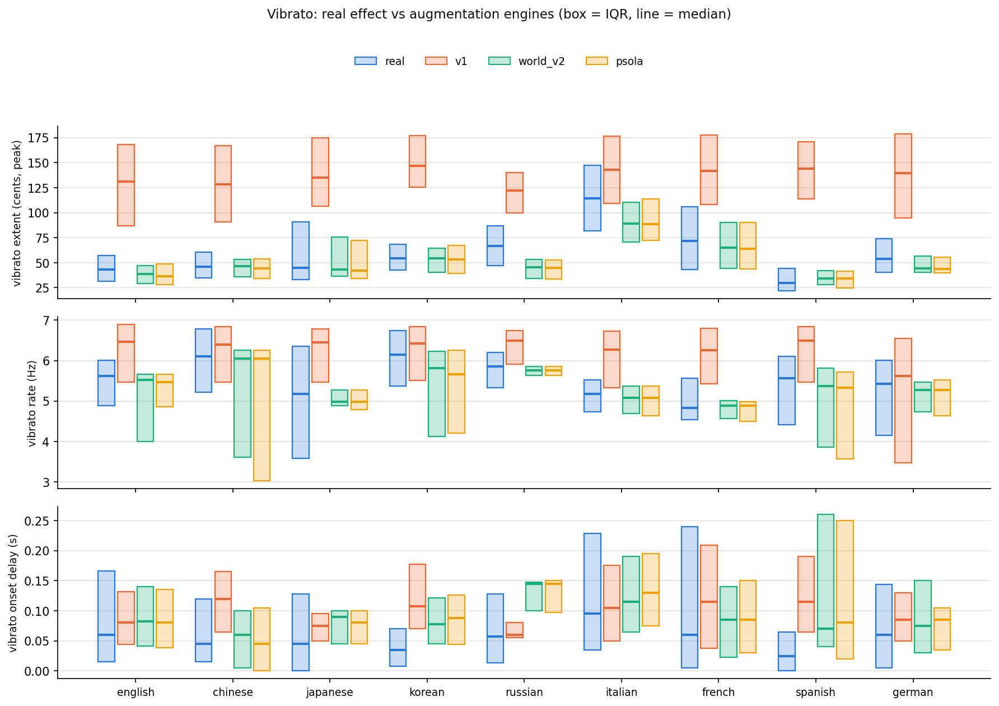
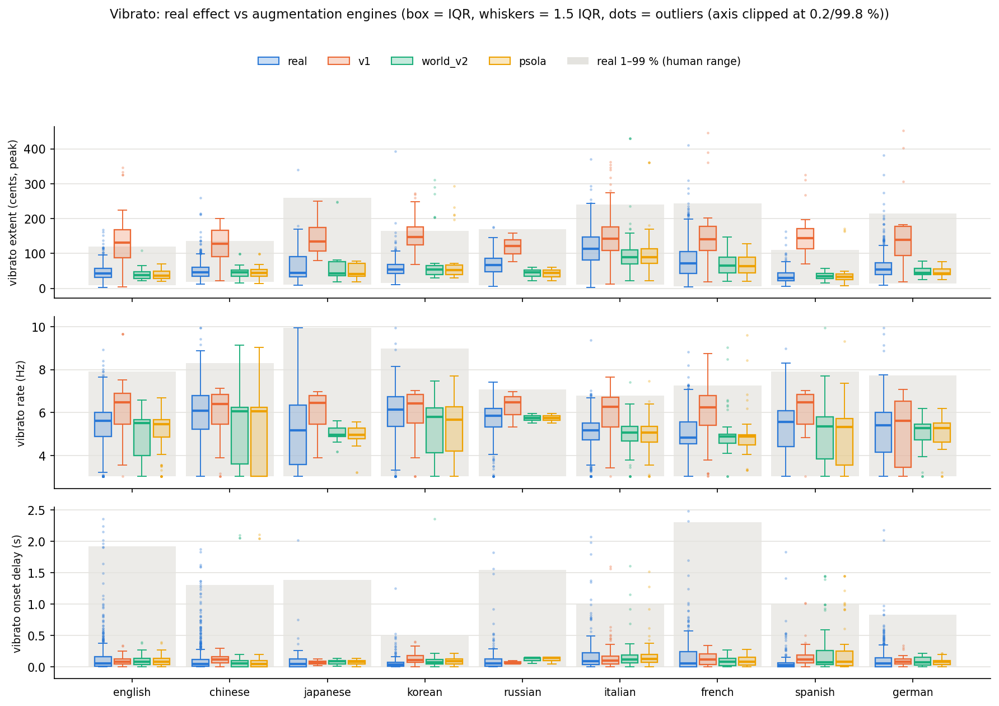

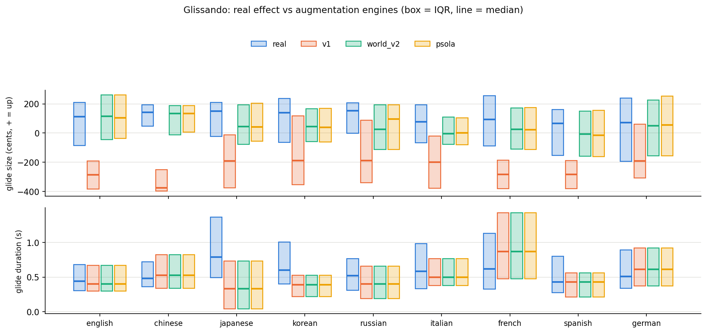
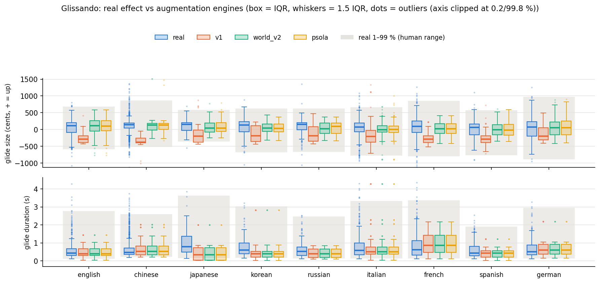

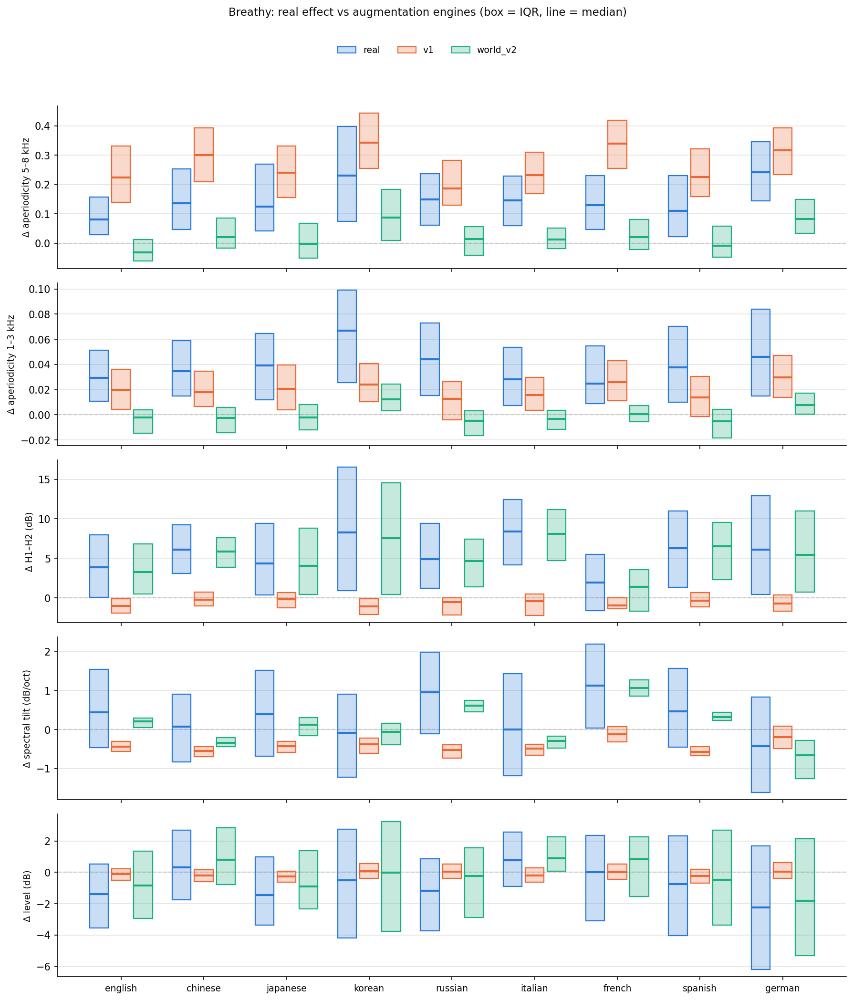
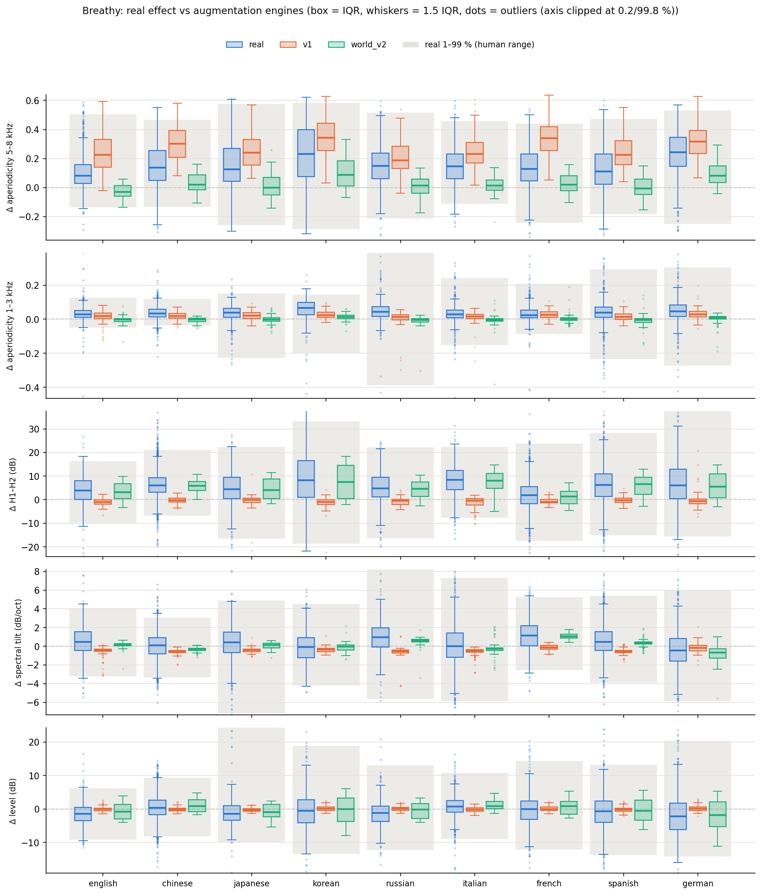

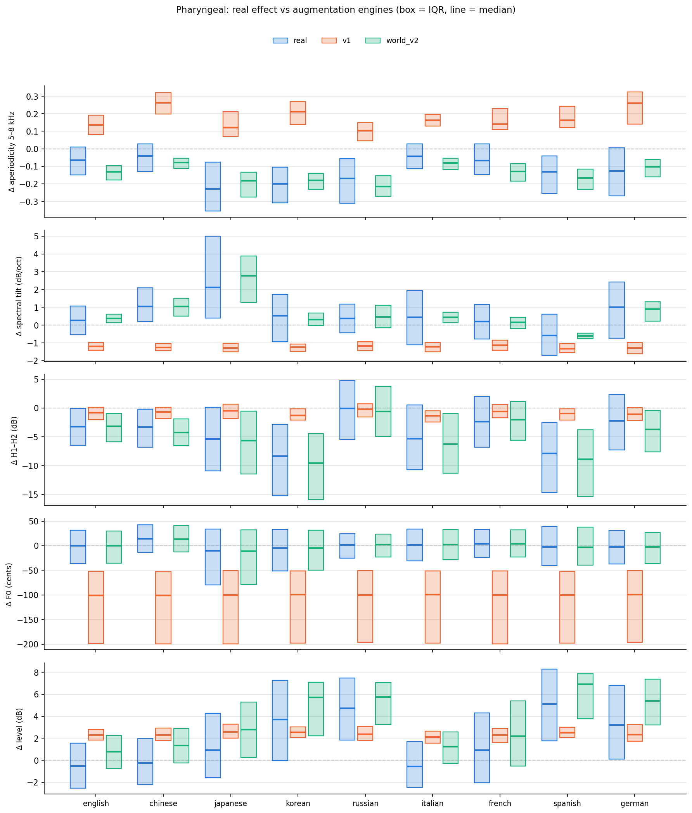
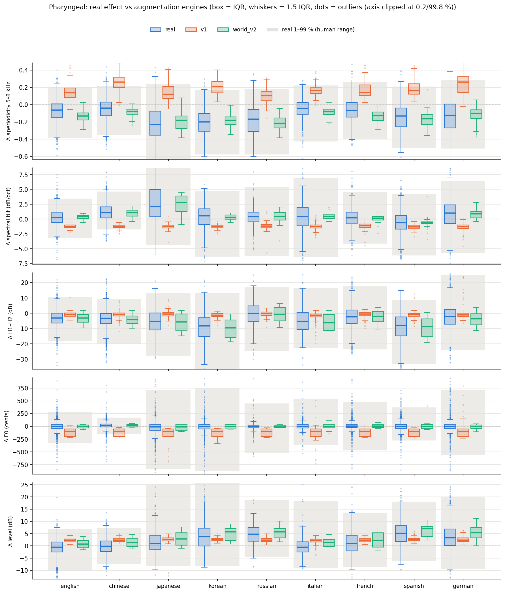

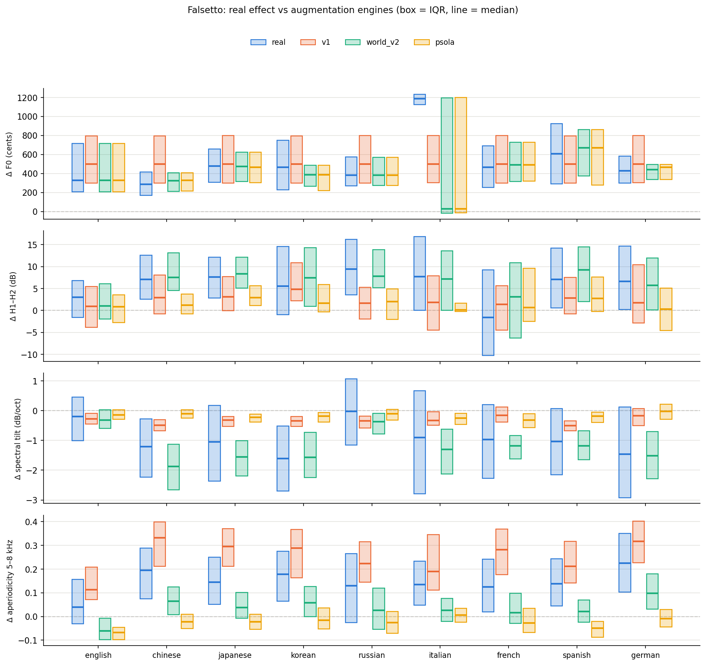
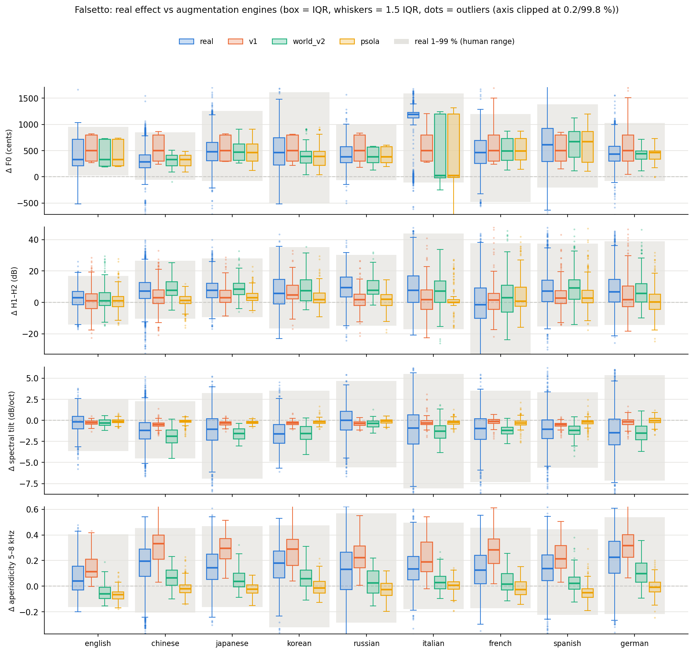

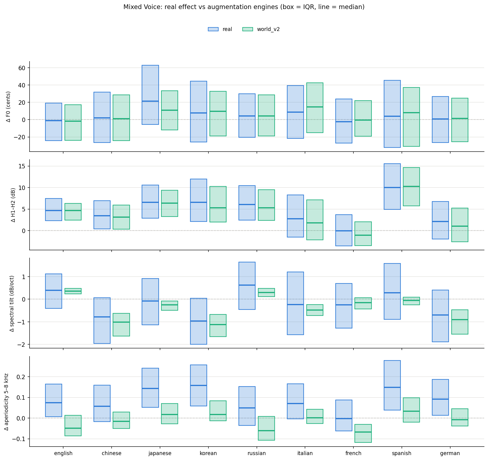
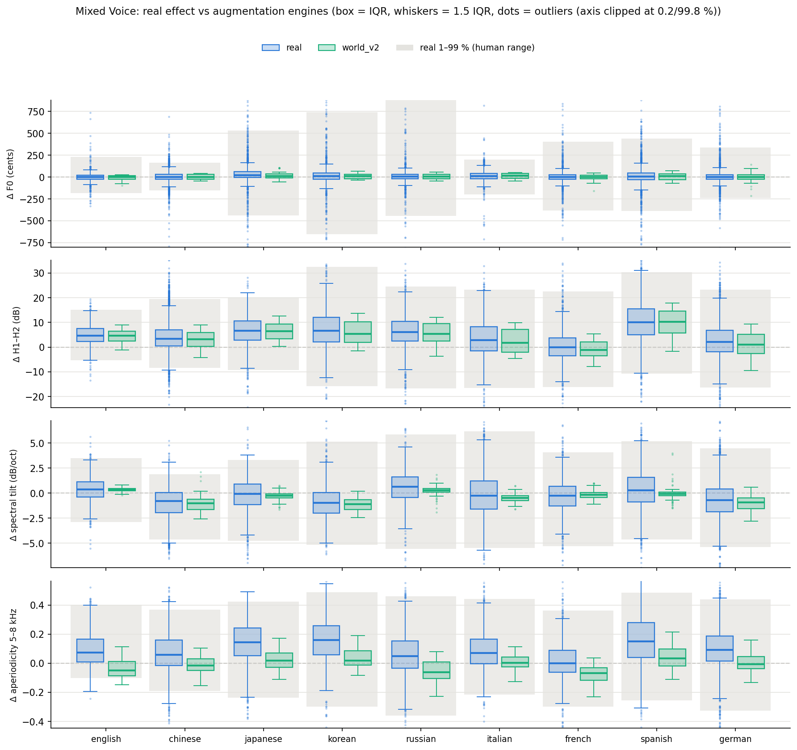

## A4. Diversity

**Spread ratio** = width of the central 90 % of the augmented values / the same width in real data, per language (median over languages). 1 = as diverse as real; below 1 = too uniform.

|                                       |     v1 |   world_v2 |   world_v2 sampled |   world_v2 tails |   psola |   psola sampled |
|:--------------------------------------|-------:|-----------:|-------------------:|-----------------:|--------:|----------------:|
| ('Breathy_Group', 'ap_1k_3k')         |   0.52 |       0.34 |               0.44 |             0.47 |  nan    |          nan    |
| ('Breathy_Group', 'ap_5k_8k')         |   0.81 |       0.42 |               0.62 |             0.74 |  nan    |          nan    |
| ('Breathy_Group', 'h1h2_db')          |   0.18 |       0.48 |               0.75 |             0.92 |  nan    |          nan    |
| ('Breathy_Group', 'level_db')         |   0.16 |       0.49 |               0.68 |             0.82 |  nan    |          nan    |
| ('Breathy_Group', 'tilt_db_oct')      |   0.15 |       0.17 |               0.2  |             0.24 |  nan    |          nan    |
| ('Falsetto_Group', 'ap_5k_8k')        |   0.76 |       0.48 |               0.71 |             0.8  |    0.39 |            0.4  |
| ('Falsetto_Group', 'f0_cents')        |   0.63 |       0.67 |               0.93 |             1.07 |    0.67 |            0.93 |
| ('Falsetto_Group', 'h1h2_db')         |   0.89 |       0.91 |               0.99 |             1.05 |    0.76 |            0.77 |
| ('Falsetto_Group', 'tilt_db_oct')     |   0.17 |       0.34 |               0.45 |             0.5  |    0.21 |            0.2  |
| ('Glissando_Group', 'glide_cents')    |   0.79 |       0.87 |               0.99 |             1.08 |    0.83 |            0.99 |
| ('Glissando_Group', 'glide_dur_s')    |   0.9  |       0.9  |               0.9  |             0.9  |    0.9  |            0.9  |
| ('Mixed_Voice_Group', 'ap_5k_8k')     | nan    |       0.4  |               0.62 |             0.75 |  nan    |          nan    |
| ('Mixed_Voice_Group', 'f0_cents')     | nan    |       0.3  |               0.91 |             1.13 |  nan    |          nan    |
| ('Mixed_Voice_Group', 'h1h2_db')      | nan    |       0.53 |               0.9  |             1.05 |  nan    |          nan    |
| ('Mixed_Voice_Group', 'tilt_db_oct')  | nan    |       0.2  |               0.28 |             0.32 |  nan    |          nan    |
| ('Pharyngeal_Group', 'ap_5k_8k')      |   0.62 |       0.47 |               0.58 |             0.67 |  nan    |          nan    |
| ('Pharyngeal_Group', 'f0_cents')      |   0.59 |       0.2  |               0.68 |             1.04 |  nan    |          nan    |
| ('Pharyngeal_Group', 'h1h2_db')       |   0.25 |       0.51 |               0.89 |             0.97 |  nan    |          nan    |
| ('Pharyngeal_Group', 'level_db')      |   0.18 |       0.42 |               0.66 |             0.84 |  nan    |          nan    |
| ('Pharyngeal_Group', 'tilt_db_oct')   |   0.2  |       0.25 |               0.34 |             0.45 |  nan    |          nan    |
| ('Vibrato_Group', 'vib_extent_cents') |   2.24 |       0.66 |               0.79 |             0.8  |    0.66 |            0.79 |
| ('Vibrato_Group', 'vib_onset_s')      |   0.56 |       0.55 |               1    |             0.59 |    0.53 |            0.94 |
| ('Vibrato_Group', 'vib_rate_hz')      |   0.92 |       0.79 |               0.97 |             0.93 |    0.78 |            0.97 |

**Between-language ratio** = how much the per-language medians differ, augmented / real (1 = languages differ as much as in real data).

|                                       |     v1 |   world_v2 |   world_v2 sampled |   world_v2 tails |   psola |   psola sampled |
|:--------------------------------------|-------:|-----------:|-------------------:|-----------------:|--------:|----------------:|
| ('Breathy_Group', 'ap_1k_3k')         |   0.45 |       0.48 |               0.56 |             0.43 |  nan    |          nan    |
| ('Breathy_Group', 'ap_5k_8k')         |   1.08 |       0.74 |               0.82 |             0.55 |  nan    |          nan    |
| ('Breathy_Group', 'h1h2_db')          |   0.17 |       1.03 |               1.09 |             1.01 |  nan    |          nan    |
| ('Breathy_Group', 'level_db')         |   0.14 |       0.96 |               1.35 |             1.08 |  nan    |          nan    |
| ('Breathy_Group', 'tilt_db_oct')      |   0.32 |       1.06 |               1.14 |             1    |  nan    |          nan    |
| ('Falsetto_Group', 'ap_5k_8k')        |   1.35 |       0.83 |               0.78 |             0.91 |    0.42 |            0.45 |
| ('Falsetto_Group', 'f0_cents')        |   0    |       0.64 |               0.61 |             0.68 |    0.64 |            0.64 |
| ('Falsetto_Group', 'h1h2_db')         |   0.36 |       0.81 |               0.73 |             0.83 |    0.31 |            0.31 |
| ('Falsetto_Group', 'tilt_db_oct')     |   0.23 |       1.02 |               1.04 |             1.02 |    0.16 |            0.14 |
| ('Glissando_Group', 'glide_cents')    |   1.9  |       1.37 |               1.35 |             1.4  |    1.42 |            1.4  |
| ('Glissando_Group', 'glide_dur_s')    |   1.46 |       1.46 |               1.46 |             1.46 |    1.46 |            1.46 |
| ('Mixed_Voice_Group', 'ap_5k_8k')     | nan    |       0.69 |               0.75 |             0.78 |  nan    |          nan    |
| ('Mixed_Voice_Group', 'f0_cents')     | nan    |       0.8  |               1.06 |             1.26 |  nan    |          nan    |
| ('Mixed_Voice_Group', 'h1h2_db')      | nan    |       1.11 |               1.16 |             1.32 |  nan    |          nan    |
| ('Mixed_Voice_Group', 'tilt_db_oct')  | nan    |       0.99 |               0.91 |             0.92 |  nan    |          nan    |
| ('Pharyngeal_Group', 'ap_5k_8k')      |   0.84 |       0.69 |               0.75 |             0.6  |  nan    |          nan    |
| ('Pharyngeal_Group', 'f0_cents')      |   0.08 |       0.99 |               1.59 |             2.43 |  nan    |          nan    |
| ('Pharyngeal_Group', 'h1h2_db')       |   0.14 |       1.1  |               1.18 |             1.64 |  nan    |          nan    |
| ('Pharyngeal_Group', 'level_db')      |   0.07 |       1.04 |               1.17 |             1.16 |  nan    |          nan    |
| ('Pharyngeal_Group', 'tilt_db_oct')   |   0.08 |       1.24 |               1.07 |             1.36 |  nan    |          nan    |
| ('Vibrato_Group', 'vib_extent_cents') |   0.25 |       0.69 |               0.71 |             0.8  |    0.7  |            0.65 |
| ('Vibrato_Group', 'vib_onset_s')      |   0.83 |       0.77 |               1.03 |             0.84 |    1.08 |            1.05 |
| ('Vibrato_Group', 'vib_rate_hz')      |   0.63 |       0.89 |               0.48 |             1.31 |    0.84 |            0.78 |

## A5. Coverage of the tails and of the human range

**Outside human range** = share of augmented values outside the real 1–99 % of their language (should be ≈ 0.02).

|                                       |     v1 |   world_v2 |   world_v2 sampled |   world_v2 tails |   psola |   psola sampled |
|:--------------------------------------|-------:|-----------:|-------------------:|-----------------:|--------:|----------------:|
| ('Breathy_Group', 'ap_1k_3k')         |   0.01 |       0    |               0.01 |             0.01 |  nan    |          nan    |
| ('Breathy_Group', 'ap_5k_8k')         |   0.06 |       0    |               0.01 |             0.02 |  nan    |          nan    |
| ('Breathy_Group', 'h1h2_db')          |   0.01 |       0    |               0    |             0.01 |  nan    |          nan    |
| ('Breathy_Group', 'level_db')         |   0    |       0    |               0    |             0.02 |  nan    |          nan    |
| ('Breathy_Group', 'tilt_db_oct')      |   0    |       0    |               0    |             0    |  nan    |          nan    |
| ('Falsetto_Group', 'ap_5k_8k')        |   0.05 |       0    |               0.01 |             0.01 |    0    |            0.01 |
| ('Falsetto_Group', 'f0_cents')        |   0.01 |       0    |               0    |             0.01 |    0    |            0    |
| ('Falsetto_Group', 'h1h2_db')         |   0.03 |       0.02 |               0.03 |             0.04 |    0.02 |            0.02 |
| ('Falsetto_Group', 'tilt_db_oct')     |   0    |       0    |               0    |             0    |    0    |            0    |
| ('Glissando_Group', 'glide_cents')    |   0.05 |       0.02 |               0.02 |             0.03 |    0.02 |            0.02 |
| ('Glissando_Group', 'glide_dur_s')    |   0.13 |       0.13 |               0.13 |             0.13 |    0.13 |            0.13 |
| ('Mixed_Voice_Group', 'ap_5k_8k')     | nan    |       0.02 |               0.03 |             0.04 |  nan    |          nan    |
| ('Mixed_Voice_Group', 'f0_cents')     | nan    |       0    |               0    |             0    |  nan    |          nan    |
| ('Mixed_Voice_Group', 'h1h2_db')      | nan    |       0    |               0.01 |             0.01 |  nan    |          nan    |
| ('Mixed_Voice_Group', 'tilt_db_oct')  | nan    |       0    |               0    |             0    |  nan    |          nan    |
| ('Pharyngeal_Group', 'ap_5k_8k')      |   0.33 |       0    |               0    |             0    |  nan    |          nan    |
| ('Pharyngeal_Group', 'f0_cents')      |   0.04 |       0    |               0    |             0    |  nan    |          nan    |
| ('Pharyngeal_Group', 'h1h2_db')       |   0    |       0    |               0    |             0.01 |  nan    |          nan    |
| ('Pharyngeal_Group', 'level_db')      |   0    |       0    |               0    |             0    |  nan    |          nan    |
| ('Pharyngeal_Group', 'tilt_db_oct')   |   0.01 |       0    |               0    |             0    |  nan    |          nan    |
| ('Vibrato_Group', 'vib_extent_cents') |   0.34 |       0.03 |               0.04 |             0.04 |    0.03 |            0.03 |
| ('Vibrato_Group', 'vib_onset_s')      |   0.01 |       0.02 |               0.03 |             0.03 |    0.02 |            0.02 |
| ('Vibrato_Group', 'vib_rate_hz')      |   0.04 |       0.01 |               0.02 |             0.02 |    0.02 |            0.02 |

**Tail share** = share of augmented values in the real outer deciles (< p10 or > p90). Real data: 0.20. Higher = more weight on under-represented values.

|                                       |     v1 |   world_v2 |   world_v2 sampled |   world_v2 tails |   psola |   psola sampled |
|:--------------------------------------|-------:|-----------:|-------------------:|-----------------:|--------:|----------------:|
| ('Breathy_Group', 'ap_1k_3k')         |   0.13 |       0.31 |               0.31 |             0.35 |  nan    |          nan    |
| ('Breathy_Group', 'ap_5k_8k')         |   0.27 |       0.32 |               0.36 |             0.44 |  nan    |          nan    |
| ('Breathy_Group', 'h1h2_db')          |   0.15 |       0    |               0.13 |             0.23 |  nan    |          nan    |
| ('Breathy_Group', 'level_db')         |   0    |       0.01 |               0.13 |             0.22 |  nan    |          nan    |
| ('Breathy_Group', 'tilt_db_oct')      |   0.02 |       0    |               0.01 |             0.01 |  nan    |          nan    |
| ('Falsetto_Group', 'ap_5k_8k')        |   0.27 |       0.19 |               0.26 |             0.34 |    0.41 |            0.42 |
| ('Falsetto_Group', 'f0_cents')        |   0.12 |       0.08 |               0.2  |             0.26 |    0.08 |            0.2  |
| ('Falsetto_Group', 'h1h2_db')         |   0.21 |       0.13 |               0.21 |             0.25 |    0.17 |            0.17 |
| ('Falsetto_Group', 'tilt_db_oct')     |   0.01 |       0.01 |               0.03 |             0.04 |    0.01 |            0.01 |
| ('Glissando_Group', 'glide_cents')    |   0.5  |       0.16 |               0.21 |             0.24 |    0.16 |            0.22 |
| ('Glissando_Group', 'glide_dur_s')    |   0.31 |       0.31 |               0.31 |             0.31 |    0.31 |            0.31 |
| ('Mixed_Voice_Group', 'ap_5k_8k')     | nan    |       0.21 |               0.28 |             0.32 |  nan    |          nan    |
| ('Mixed_Voice_Group', 'f0_cents')     | nan    |       0.01 |               0.23 |             0.31 |  nan    |          nan    |
| ('Mixed_Voice_Group', 'h1h2_db')      | nan    |       0.01 |               0.25 |             0.32 |  nan    |          nan    |
| ('Mixed_Voice_Group', 'tilt_db_oct')  | nan    |       0    |               0.02 |             0.03 |  nan    |          nan    |
| ('Pharyngeal_Group', 'ap_5k_8k')      |   0.87 |       0.02 |               0.05 |             0.09 |  nan    |          nan    |
| ('Pharyngeal_Group', 'f0_cents')      |   0.56 |       0    |               0.16 |             0.23 |  nan    |          nan    |
| ('Pharyngeal_Group', 'h1h2_db')       |   0.02 |       0    |               0.18 |             0.25 |  nan    |          nan    |
| ('Pharyngeal_Group', 'level_db')      |   0.02 |       0.01 |               0.12 |             0.2  |  nan    |          nan    |
| ('Pharyngeal_Group', 'tilt_db_oct')   |   0.31 |       0.01 |               0.02 |             0.03 |  nan    |          nan    |
| ('Vibrato_Group', 'vib_extent_cents') |   0.73 |       0.08 |               0.17 |             0.25 |    0.09 |            0.17 |
| ('Vibrato_Group', 'vib_onset_s')      |   0.1  |       0.07 |               0.11 |             0.09 |    0.08 |            0.11 |
| ('Vibrato_Group', 'vib_rate_hz')      |   0.29 |       0.12 |               0.21 |             0.22 |    0.12 |            0.22 |

**KS distance** to the real distribution (0 = same distribution).

|                                       |     v1 |   world_v2 |   world_v2 sampled |   world_v2 tails |   psola |   psola sampled |
|:--------------------------------------|-------:|-----------:|-------------------:|-----------------:|--------:|----------------:|
| ('Breathy_Group', 'ap_1k_3k')         |   0.26 |       0.64 |               0.62 |             0.58 |  nan    |          nan    |
| ('Breathy_Group', 'ap_5k_8k')         |   0.39 |       0.5  |               0.45 |             0.43 |  nan    |          nan    |
| ('Breathy_Group', 'h1h2_db')          |   0.67 |       0.19 |               0.1  |             0.18 |  nan    |          nan    |
| ('Breathy_Group', 'level_db')         |   0.44 |       0.21 |               0.13 |             0.18 |  nan    |          nan    |
| ('Breathy_Group', 'tilt_db_oct')      |   0.6  |       0.42 |               0.37 |             0.32 |  nan    |          nan    |
| ('Falsetto_Group', 'ap_5k_8k')        |   0.36 |       0.42 |               0.37 |             0.38 |    0.66 |            0.63 |
| ('Falsetto_Group', 'f0_cents')        |   0.31 |       0.21 |               0.14 |             0.2  |    0.22 |            0.15 |
| ('Falsetto_Group', 'h1h2_db')         |   0.25 |       0.14 |               0.13 |             0.16 |    0.32 |            0.32 |
| ('Falsetto_Group', 'tilt_db_oct')     |   0.48 |       0.31 |               0.25 |             0.21 |    0.49 |            0.47 |
| ('Glissando_Group', 'glide_cents')    |   0.54 |       0.17 |               0.19 |             0.17 |    0.18 |            0.18 |
| ('Glissando_Group', 'glide_dur_s')    |   0.21 |       0.21 |               0.21 |             0.21 |    0.21 |            0.21 |
| ('Mixed_Voice_Group', 'ap_5k_8k')     | nan    |       0.45 |               0.37 |             0.35 |  nan    |          nan    |
| ('Mixed_Voice_Group', 'f0_cents')     | nan    |       0.21 |               0.1  |             0.18 |  nan    |          nan    |
| ('Mixed_Voice_Group', 'h1h2_db')      | nan    |       0.17 |               0.12 |             0.19 |  nan    |          nan    |
| ('Mixed_Voice_Group', 'tilt_db_oct')  | nan    |       0.37 |               0.3  |             0.3  |  nan    |          nan    |
| ('Pharyngeal_Group', 'ap_5k_8k')      |   0.83 |       0.32 |               0.24 |             0.21 |  nan    |          nan    |
| ('Pharyngeal_Group', 'f0_cents')      |   0.77 |       0.21 |               0.13 |             0.15 |  nan    |          nan    |
| ('Pharyngeal_Group', 'h1h2_db')       |   0.43 |       0.18 |               0.12 |             0.15 |  nan    |          nan    |
| ('Pharyngeal_Group', 'level_db')      |   0.53 |       0.3  |               0.25 |             0.21 |  nan    |          nan    |
| ('Pharyngeal_Group', 'tilt_db_oct')   |   0.7  |       0.31 |               0.26 |             0.21 |  nan    |          nan    |
| ('Vibrato_Group', 'vib_extent_cents') |   0.75 |       0.2  |               0.15 |             0.21 |    0.18 |            0.17 |
| ('Vibrato_Group', 'vib_onset_s')      |   0.33 |       0.2  |               0.2  |             0.14 |    0.22 |            0.18 |
| ('Vibrato_Group', 'vib_rate_hz')      |   0.42 |       0.24 |               0.17 |             0.21 |    0.25 |            0.18 |

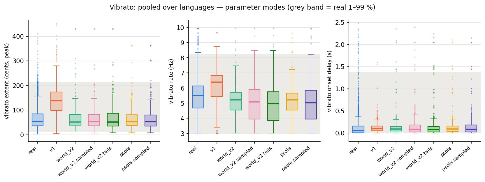
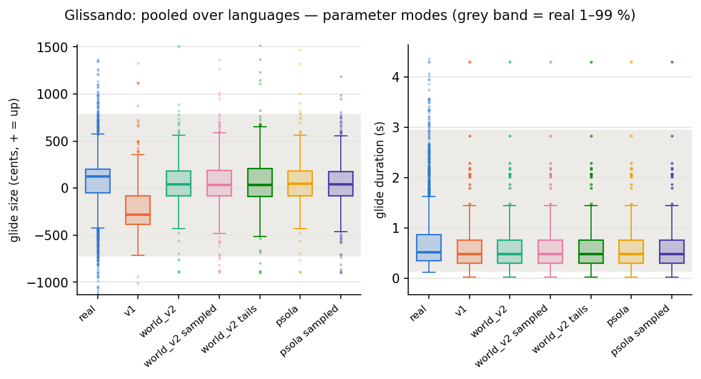
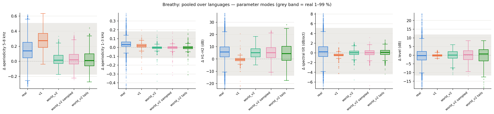
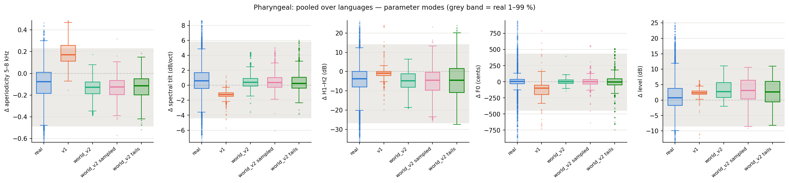
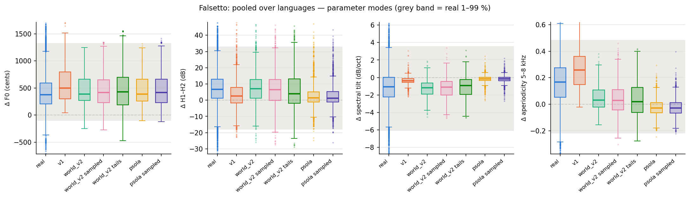
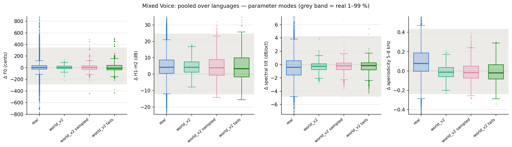

## A6. Language, singer, voice type or register?

η² = share of the variance of the real effect explained by each factor (singer is nested in language, so η²(singer) ≥ η²(language)). Register = tercile of the control pitch within each singer.

| group             | feature                      |     n |   eta2_language |   eta2_voice |   eta2_singer |   eta2_register |   spearman_rel_pitch |   median_low |   median_mid |   median_high |
|:------------------|:-----------------------------|------:|----------------:|-------------:|--------------:|----------------:|---------------------:|-------------:|-------------:|--------------:|
| Vibrato_Group     | vibrato extent (cents, peak) |  3327 |           0.299 |        0.132 |         0.327 |           0.004 |               -0.11  |       56.952 |       52.311 |        49.182 |
| Vibrato_Group     | vibrato rate (Hz)            |  3327 |           0.081 |        0.028 |         0.171 |           0.006 |               -0.078 |        5.591 |        5.518 |         5.322 |
| Vibrato_Group     | vibrato onset delay (s)      |  3327 |           0.016 |        0.004 |         0.043 |           0.001 |               -0.011 |        0.06  |        0.055 |         0.055 |
| Glissando_Group   | glide size (cents, + = up)   |  4068 |           0.015 |        0.009 |         0.021 |           0.002 |                0.047 |      104.96  |      124.588 |       126.918 |
| Glissando_Group   | glide duration (s)           |  4081 |           0.024 |        0.008 |         0.029 |           0.004 |                0.034 |        0.52  |        0.48  |         0.55  |
| Breathy_Group     | Δ aperiodicity 5–8 kHz       | 10792 |           0.051 |        0.004 |         0.128 |           0.058 |                0.276 |        0.089 |        0.157 |         0.194 |
| Breathy_Group     | Δ aperiodicity 1–3 kHz       | 10792 |           0.007 |        0.004 |         0.049 |           0.001 |               -0.004 |        0.035 |        0.036 |         0.033 |
| Breathy_Group     | Δ H1–H2 (dB)                 | 10792 |           0.052 |        0.044 |         0.124 |           0.001 |               -0.06  |        6.016 |        5.753 |         4.914 |
| Breathy_Group     | Δ spectral tilt (dB/oct)     | 10792 |           0.045 |        0.005 |         0.068 |           0.049 |               -0.26  |        0.596 |        0.21  |        -0.319 |
| Breathy_Group     | Δ level (dB)                 | 10792 |           0.033 |        0.027 |         0.191 |           0.007 |               -0.098 |        0.1   |       -0.296 |        -0.658 |
| Pharyngeal_Group  | Δ aperiodicity 5–8 kHz       | 11301 |           0.118 |        0.067 |         0.244 |           0.001 |               -0.015 |       -0.075 |       -0.076 |        -0.076 |
| Pharyngeal_Group  | Δ spectral tilt (dB/oct)     | 11301 |           0.131 |        0.02  |         0.219 |           0.034 |                0.192 |        0.175 |        0.608 |         0.848 |
| Pharyngeal_Group  | Δ H1–H2 (dB)                 | 11301 |           0.093 |        0.067 |         0.158 |           0     |                0.016 |       -4.022 |       -3.544 |        -3.556 |
| Pharyngeal_Group  | Δ F0 (cents)                 | 11301 |           0.008 |        0.01  |         0.031 |           0.017 |               -0.082 |        8.441 |        5.663 |         2.993 |
| Pharyngeal_Group  | Δ level (dB)                 | 11301 |           0.192 |        0.158 |         0.263 |           0.004 |               -0.037 |        1.236 |        0.571 |         0.635 |
| Falsetto_Group    | Δ F0 (cents)                 | 20408 |           0.285 |        0.496 |         0.62  |           0.028 |               -0.18  |      419.512 |      369.783 |       327.472 |
| Falsetto_Group    | Δ H1–H2 (dB)                 | 20408 |           0.049 |        0.145 |         0.215 |           0.007 |                0.039 |        6.407 |        5.878 |         7.432 |
| Falsetto_Group    | Δ spectral tilt (dB/oct)     | 20408 |           0.025 |        0.05  |         0.127 |           0.045 |               -0.234 |       -0.559 |       -1.122 |        -1.548 |
| Falsetto_Group    | Δ aperiodicity 5–8 kHz       | 20408 |           0.047 |        0.054 |         0.141 |           0.048 |                0.239 |        0.11  |        0.175 |         0.213 |
| Mixed_Voice_Group | Δ F0 (cents)                 | 22633 |           0.007 |        0.001 |         0.014 |           0.014 |               -0.098 |        8.558 |        3.948 |        -0.169 |
| Mixed_Voice_Group | Δ H1–H2 (dB)                 | 22633 |           0.129 |        0.075 |         0.219 |           0.001 |               -0.007 |        4.209 |        4.107 |         4.082 |
| Mixed_Voice_Group | Δ spectral tilt (dB/oct)     | 22633 |           0.09  |        0.09  |         0.184 |           0.039 |               -0.212 |       -0.099 |       -0.441 |        -0.77  |
| Mixed_Voice_Group | Δ aperiodicity 5–8 kHz       | 22633 |           0.072 |        0.074 |         0.173 |           0.005 |                0.054 |        0.062 |        0.089 |         0.085 |

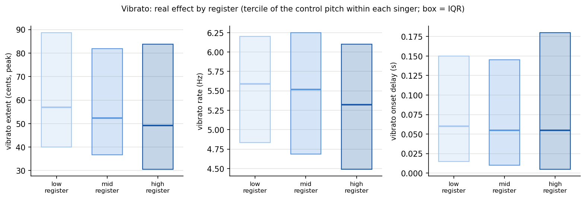
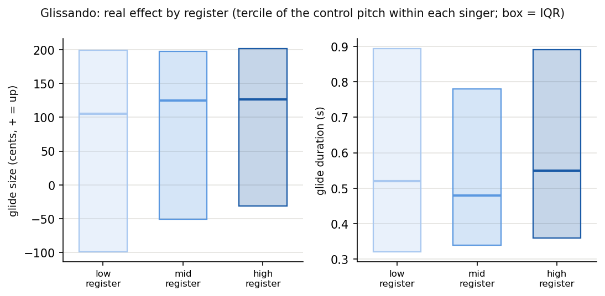
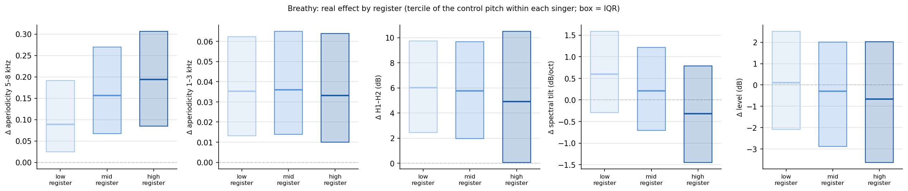
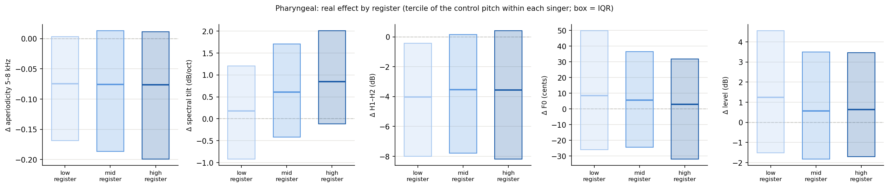
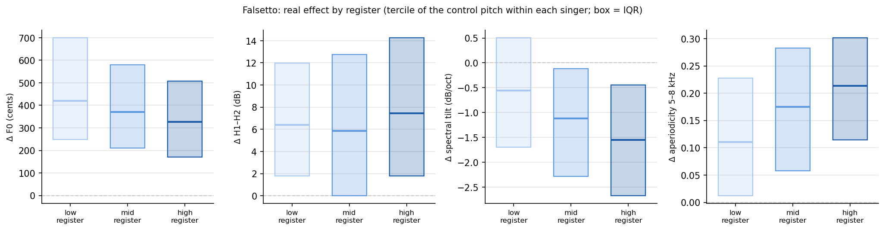
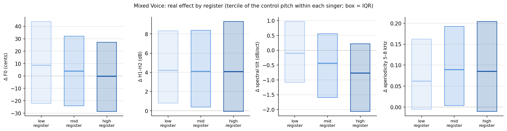

## A7. Do the targets rest on one performer?

Leave-one-singer-out: largest shift of the median target when one singer is removed, in IQR units (> 0.5 = the target depends noticeably on one performer). Languages with one singer cannot be checked (NaN).

|                                       |   english |   chinese |   japanese |   korean |   italian |   french |   spanish |   german |
|:--------------------------------------|----------:|----------:|-----------:|---------:|----------:|---------:|----------:|---------:|
| ('Breathy_Group', 'ap_1k_3k')         |      0.22 |      0.2  |       0.23 |     0.63 |      0.3  |     0.73 |      0.36 |     0.4  |
| ('Breathy_Group', 'ap_5k_8k')         |      0.24 |      0.03 |       0.21 |     0.56 |      0.34 |     0.08 |      0.38 |     0.35 |
| ('Breathy_Group', 'h1h2_db')          |      0.37 |      0.01 |       0.25 |     0.53 |      0.03 |     0    |      0.32 |     0.1  |
| ('Breathy_Group', 'level_db')         |      0.25 |      0.44 |       0.43 |     0.24 |      0.05 |     0.46 |      0.43 |     0.51 |
| ('Breathy_Group', 'tilt_db_oct')      |      0.28 |      0.08 |       0    |     0.02 |      0.02 |     0.21 |      0.38 |     0.01 |
| ('Falsetto_Group', 'ap_5k_8k')        |    nan    |      0.36 |       0.26 |     0.1  |      0.09 |     0.5  |      0.24 |     0.51 |
| ('Falsetto_Group', 'f0_cents')        |    nan    |      0.5  |       0.66 |     0.38 |      0.49 |     0.6  |      0.55 |     0.34 |
| ('Falsetto_Group', 'h1h2_db')         |    nan    |      0.32 |       0.24 |     0.35 |      0.16 |     0.84 |      0.32 |     0.34 |
| ('Falsetto_Group', 'tilt_db_oct')     |    nan    |      0.32 |       0.5  |     0.08 |      0.35 |     0.49 |      0    |     0.2  |
| ('Glissando_Group', 'glide_cents')    |      0.01 |      0.04 |       0.03 |     0.05 |      0.11 |     0.15 |      0.13 |     0.08 |
| ('Glissando_Group', 'glide_dur_s')    |      0.21 |      0    |       0.39 |     0.07 |      0.09 |     0.03 |      0.01 |     0.1  |
| ('Mixed_Voice_Group', 'ap_5k_8k')     |    nan    |      0.31 |       0.05 |     0.24 |      0.19 |     0.07 |      0.41 |     0.46 |
| ('Mixed_Voice_Group', 'f0_cents')     |    nan    |      0.03 |       0.53 |     0.09 |      0.3  |     0.15 |      0.07 |     0.03 |
| ('Mixed_Voice_Group', 'h1h2_db')      |    nan    |      0.23 |       0.62 |     0.29 |      0.14 |     0.19 |      0.38 |     0.28 |
| ('Mixed_Voice_Group', 'tilt_db_oct')  |    nan    |      0.4  |       0.21 |     0.01 |      0.06 |     0.33 |      0.22 |     0.24 |
| ('Pharyngeal_Group', 'ap_5k_8k')      |      0.14 |      0.17 |       0.53 |     0.19 |      0.38 |     0.34 |      0.37 |     0.44 |
| ('Pharyngeal_Group', 'f0_cents')      |      0.21 |      0.24 |       0.43 |     0.02 |      0.18 |     0.15 |      0.03 |     0.03 |
| ('Pharyngeal_Group', 'h1h2_db')       |      0.12 |      0.16 |       0.31 |     0.38 |      0.11 |     0.09 |      0.47 |     0.32 |
| ('Pharyngeal_Group', 'level_db')      |      0.17 |      0.15 |       0.4  |     0.14 |      0.07 |     0.45 |      0.21 |     0.38 |
| ('Pharyngeal_Group', 'tilt_db_oct')   |      0.11 |      0.03 |       0.56 |     0.12 |      0.18 |     0.17 |      0.01 |     0.51 |
| ('Vibrato_Group', 'vib_extent_cents') |      0.28 |      0.09 |       0.01 |     0.69 |      0.03 |     0.46 |      0.62 |     0.16 |
| ('Vibrato_Group', 'vib_onset_s')      |      0.17 |      0.29 |       0.2  |     0.24 |      0.03 |     0.17 |      0.23 |     0.07 |
| ('Vibrato_Group', 'vib_rate_hz')      |      0.24 |      0.56 |       0.12 |     0.82 |      0.12 |     1.57 |      0.01 |     0.11 |

Largest single-singer share of spans per language: english 100%, chinese 64%, japanese 84%, korean 85%, russian 100%, italian 70%, french 88%, spanish 66%, german 60%
