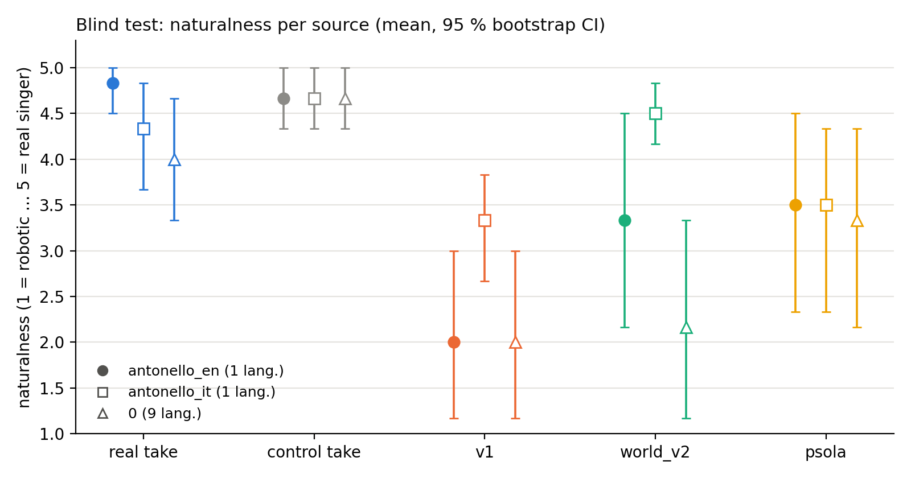
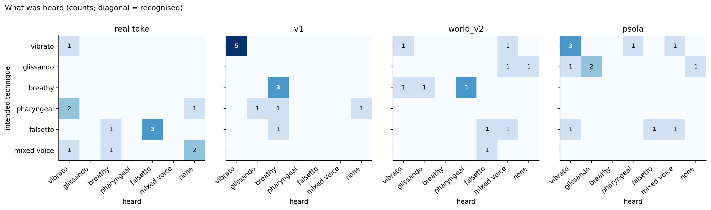

# Listening test — results

Raters/sessions pooled: antonello_en, antonello_it (60 clips; one listener). Correct = intended technique heard (for control takes: 'none'). Chance level ≈ 1/7 = 0.14. p = Mann–Whitney vs real takes, Holm-corrected.

| source   |   n | natural           |     p |   correct |   heard_none |
|:---------|----:|:------------------|------:|----------:|-------------:|
| real     |  12 | 4.58 [4.17, 4.92] |       |      0.33 |         0.25 |
| control  |  12 | 4.67 [4.42, 4.92] |       |      0.33 |         0.33 |
| legacy   |  12 | 2.67 [2.00, 3.33] | 0.001 |      0.67 |         0.08 |
| world_v2 |  12 | 3.92 [3.17, 4.58] | 0.18  |      0.17 |         0.08 |
| psola    |  12 | 3.50 [2.75, 4.17] | 0.053 |      0.5  |         0.08 |

## v1 vs the engine used for fine-tuning, per technique

**v2 as used for fine-tuning: naturalness 4.06 (n = 17, recognised 0.35) vs v1 2.67 (n = 12, recognised 0.67); Mann–Whitney p = 0.0042.**

| intended    | kind       |   n |   naturalness |   recognised |
|:------------|:-----------|----:|--------------:|-------------:|
| breathy     | v1         |   3 |          2.33 |          1   |
| breathy     | v2 as used |   5 |          4.2  |          0   |
| falsetto    | v1         |   1 |          3    |          0   |
| falsetto    | v2 as used |   2 |          5    |          0.5 |
| glissando   | v2 as used |   4 |          2.75 |          0.5 |
| mixed voice | v2 as used |   1 |          4    |          0   |
| pharyngeal  | v1         |   3 |          3.67 |          0   |
| vibrato     | v1         |   5 |          2.2  |          1   |
| vibrato     | v2 as used |   5 |          4.6  |          0.6 |

### Session antonello_en (1 lang.)

| source   |   n |   naturalness |   correct |   heard_none |
|:---------|----:|--------------:|----------:|-------------:|
| real     |   6 |          4.83 |      0.33 |         0.17 |
| control  |   6 |          4.67 |      0.5  |         0.5  |
| legacy   |   6 |          2    |      0.67 |         0.17 |
| world_v2 |   6 |          3.33 |      0.17 |         0.17 |
| psola    |   6 |          3.5  |      0.5  |         0.17 |

### Session antonello_it (1 lang.)

| source   |   n |   naturalness |   correct |   heard_none |
|:---------|----:|--------------:|----------:|-------------:|
| real     |   6 |          4.33 |      0.33 |         0.33 |
| control  |   6 |          4.67 |      0.17 |         0.17 |
| legacy   |   6 |          3.33 |      0.67 |         0    |
| world_v2 |   6 |          4.5  |      0.17 |         0    |
| psola    |   6 |          3.5  |      0.5  |         0    |

### Session 0 (9 lang.)

| source   |   n |   naturalness |   correct |   heard_none |
|:---------|----:|--------------:|----------:|-------------:|
| real     |   6 |          4    |      0.83 |         0.17 |
| control  |   6 |          4.67 |      0.5  |         0.5  |
| legacy   |   6 |          2    |      0.83 |         0.17 |
| world_v2 |   6 |          2.17 |      0    |         0.17 |
| psola    |   6 |          3.33 |      0.33 |         0    |
