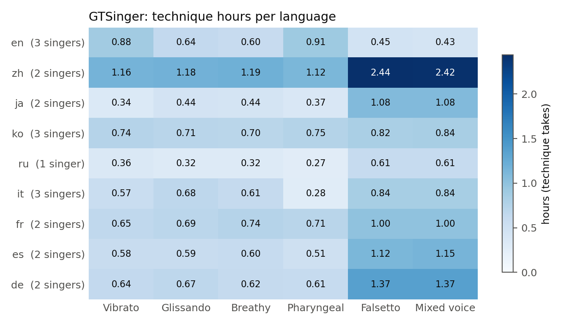
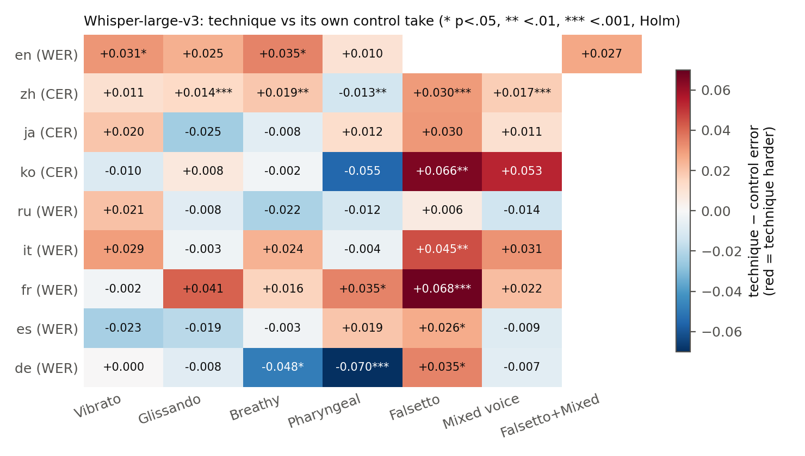
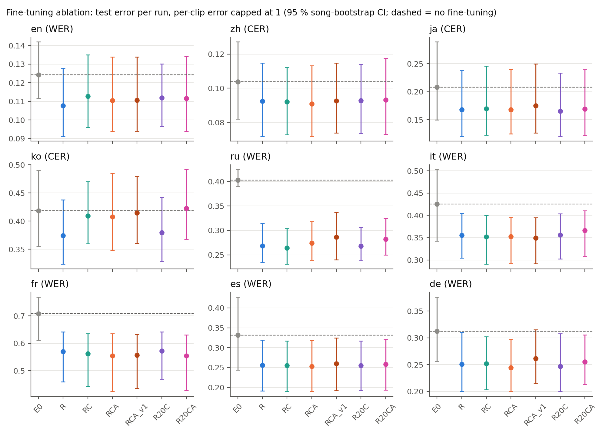
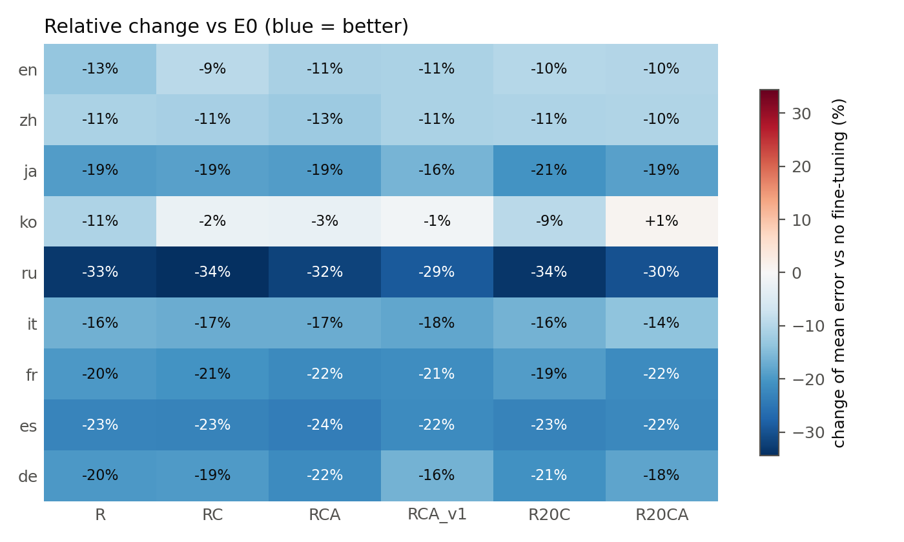
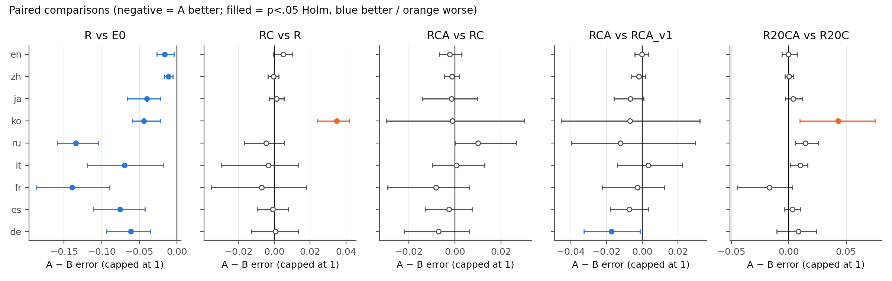
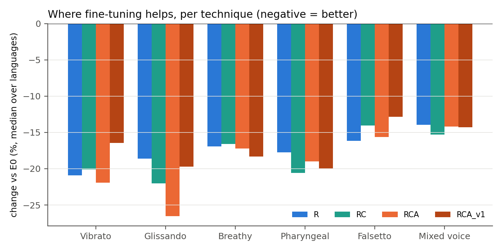

# Paper statistics (dataset, technique vs control, fine-tuning)

Generated by `scripts/paper_stats.py`. Metric = CER for zh/ja/ko, WER otherwise. CI = 95 % bootstrap over songs. p = Wilcoxon signed-rank (paired), Holm-corrected. "Capped" = per-clip error limited to 1, so that a Whisper repetition loop (error up to 40 on one clip) counts as one wrong phrase.

## B9. Dataset composition

Total: 94.0 h, 37990 clips, 20 singers. Technique takes only below (hours); every technique take has a control take of the same phrase.

| language   |   Vibrato |   Glissando |   Breathy |   Pharyngeal |   Falsetto |   Mixed voice |
|:-----------|----------:|------------:|----------:|-------------:|-----------:|--------------:|
| en         |      0.88 |        0.64 |      0.6  |         0.91 |       0.45 |          0.43 |
| zh         |      1.16 |        1.18 |      1.19 |         1.12 |       2.44 |          2.42 |
| ja         |      0.34 |        0.44 |      0.44 |         0.37 |       1.08 |          1.08 |
| ko         |      0.74 |        0.71 |      0.7  |         0.75 |       0.82 |          0.84 |
| ru         |      0.36 |        0.32 |      0.32 |         0.27 |       0.61 |          0.61 |
| it         |      0.57 |        0.68 |      0.61 |         0.28 |       0.84 |          0.84 |
| fr         |      0.65 |        0.69 |      0.74 |         0.71 |       1    |          1    |
| es         |      0.58 |        0.59 |      0.6  |         0.51 |       1.12 |          1.15 |
| de         |      0.64 |        0.67 |      0.62 |         0.61 |       1.37 |          1.37 |

Singers, voice types and hours per role:

| language   |   singers | voices         |   songs |   largest_singer_share |   control_h |   speech_h |   technique_h |   control_clips |   speech_clips |   technique_clips |
|:-----------|----------:|:---------------|--------:|-----------------------:|------------:|-----------:|--------------:|----------------:|---------------:|------------------:|
| en         |         3 | alto, tenor    |      58 |                   0.58 |        3.41 |       2.02 |          3.91 |            1254 |           1258 |              1422 |
| zh         |         2 | alto, tenor    |     118 |                   0.51 |        7.09 |       3.32 |          9.51 |            3049 |           3049 |              4090 |
| ja         |         2 | soprano, tenor |      34 |                   0.67 |        2.7  |       1.49 |          3.75 |             832 |            832 |              1168 |
| ko         |         3 | soprano, tenor |      73 |                   0.55 |        3.72 |       2.64 |          4.55 |            1032 |           1032 |              1263 |
| ru         |         1 | alto           |      22 |                   1    |        1.83 |       1.04 |          2.48 |             729 |            729 |               961 |
| it         |         3 | bass, soprano  |      35 |                   0.52 |        2.92 |       1.78 |          3.82 |             805 |            805 |              1037 |
| fr         |         2 | soprano, tenor |      76 |                   0.53 |        3.76 |       1.67 |          4.79 |            1128 |           1128 |              1419 |
| es         |         2 | bass, soprano  |      78 |                   0.56 |        3.39 |       2.27 |          4.54 |            1232 |           1232 |              1649 |
| de         |         2 | soprano, tenor |      70 |                   0.51 |        3.81 |       2.51 |          5.27 |            1448 |           1448 |              1959 |

## B8a. Is the technique take harder for Whisper than its control?

Whisper-large-v3 (no fine-tuning), whole corpus, technique take paired with the control take of the same phrase and singer. Significantly harder: 12/53 cells; significantly easier: 3/53. English baseline predates the Falsetto/Mixed split → reported together.

| language   | technique      |   n_pairs |   technique_err |   control_err | diff                    | diff_capped             |   tech_worse_share | singers_tech_worse   |       p |
|:-----------|:---------------|----------:|----------------:|--------------:|:------------------------|:------------------------|-------------------:|:---------------------|--------:|
| en         | Breathy        |       158 |           0.163 |         0.223 | -0.061 [-0.256, +0.068] | +0.035 [+0.012, +0.061] |              0.304 | 1/2                  | 0.034   |
| en         | Glissando      |       111 |           0.178 |         0.155 | +0.024 [-0.005, +0.056] | +0.025 [-0.002, +0.057] |              0.369 | 1/2                  | 0.095   |
| en         | Falsetto+Mixed |        92 |           0.134 |         0.107 | +0.027 [-0.008, +0.056] | +0.027 [-0.008, +0.057] |              0.228 | 1/1                  | 0.33    |
| en         | Pharyngeal     |       285 |           0.194 |         0.226 | -0.032 [-0.108, +0.025] | +0.010 [-0.022, +0.035] |              0.33  | 1/3                  | 0.25    |
| en         | Vibrato        |       225 |           0.195 |         0.311 | -0.116 [-0.418, +0.042] | +0.031 [+0.009, +0.049] |              0.347 | 1/3                  | 0.032   |
| zh         | Breathy        |       508 |           0.111 |         0.092 | +0.019 [+0.010, +0.028] | +0.019 [+0.010, +0.028] |              0.276 | 2/2                  | 0.0011  |
| zh         | Falsetto       |      1041 |           0.126 |         0.097 | +0.030 [+0.022, +0.038] | +0.030 [+0.022, +0.038] |              0.312 | 2/2                  | 3.9e-14 |
| zh         | Glissando      |       508 |           0.088 |         0.074 | +0.014 [+0.006, +0.023] | +0.014 [+0.006, +0.023] |              0.213 | 2/2                  | 0.00083 |
| zh         | Mixed voice    |      1041 |           0.114 |         0.097 | +0.017 [+0.011, +0.024] | +0.017 [+0.011, +0.025] |              0.252 | 2/2                  | 6e-06   |
| zh         | Pharyngeal     |       480 |           0.09  |         0.103 | -0.013 [-0.023, -0.004] | -0.013 [-0.023, -0.004] |              0.148 | 0/2                  | 0.0011  |
| zh         | Vibrato        |       512 |           0.102 |         0.091 | +0.011 [+0.004, +0.020] | +0.011 [+0.004, +0.020] |              0.193 | 2/2                  | 0.078   |
| ja         | Breathy        |       141 |           0.285 |         0.29  | -0.004 [-0.062, +0.049] | -0.008 [-0.068, +0.045] |              0.362 | 1/2                  | 1       |
| ja         | Falsetto       |       336 |           0.279 |         0.544 | -0.265 [-0.754, +0.048] | +0.030 [-0.001, +0.059] |              0.318 | 1/2                  | 0.19    |
| ja         | Glissando      |       137 |           0.264 |         0.292 | -0.029 [-0.064, +0.005] | -0.025 [-0.054, +0.007] |              0.234 | 0/2                  | 1       |
| ja         | Mixed voice    |       336 |           0.329 |         0.544 | -0.215 [-0.598, +0.021] | +0.011 [-0.009, +0.033] |              0.256 | 1/2                  | 1       |
| ja         | Pharyngeal     |       115 |           0.27  |         0.257 | +0.012 [-0.033, +0.057] | +0.012 [-0.034, +0.054] |              0.322 | 1/2                  | 1       |
| ja         | Vibrato        |       103 |           0.256 |         0.236 | +0.020 [-0.041, +0.084] | +0.020 [-0.038, +0.088] |              0.243 | 1/2                  | 1       |
| ko         | Breathy        |       196 |           0.544 |         0.721 | -0.177 [-0.552, +0.025] | -0.002 [-0.042, +0.041] |              0.434 | 1/3                  | 1       |
| ko         | Falsetto       |       231 |           0.682 |         1.046 | -0.364 [-1.117, +0.197] | +0.066 [+0.030, +0.105] |              0.515 | 2/3                  | 0.0098  |
| ko         | Glissando      |       194 |           0.667 |         0.866 | -0.199 [-0.761, +0.300] | +0.008 [-0.039, +0.060] |              0.418 | 1/3                  | 1       |
| ko         | Mixed voice    |       231 |           0.567 |         1.046 | -0.479 [-1.278, +0.152] | +0.053 [+0.003, +0.111] |              0.519 | 2/3                  | 0.071   |
| ko         | Pharyngeal     |       206 |           0.598 |         0.903 | -0.305 [-0.779, +0.174] | -0.055 [-0.089, -0.020] |              0.388 | 1/3                  | 0.052   |
| ko         | Vibrato        |       205 |           0.981 |         0.483 | +0.498 [-0.031, +1.440] | -0.010 [-0.058, +0.040] |              0.415 | 3/3                  | 1       |
| ru         | Breathy        |       128 |           0.424 |         0.447 | -0.023 [-0.088, +0.048] | -0.022 [-0.083, +0.041] |              0.312 | 0/1                  | 1       |
| ru         | Falsetto       |       232 |           0.46  |         0.444 | +0.017 [-0.017, +0.054] | +0.006 [-0.028, +0.043] |              0.362 | 1/1                  | 1       |
| ru         | Glissando      |       122 |           0.486 |         0.486 | -0.000 [-0.066, +0.057] | -0.008 [-0.072, +0.047] |              0.361 | 0/1                  | 1       |
| ru         | Mixed voice    |       232 |           0.432 |         0.444 | -0.011 [-0.049, +0.025] | -0.014 [-0.049, +0.020] |              0.336 | 0/1                  | 1       |
| ru         | Pharyngeal     |       109 |           0.463 |         0.466 | -0.003 [-0.069, +0.046] | -0.012 [-0.069, +0.034] |              0.321 | 0/1                  | 1       |
| ru         | Vibrato        |       138 |           0.491 |         0.454 | +0.037 [-0.033, +0.132] | +0.021 [-0.041, +0.096] |              0.326 | 1/1                  | 1       |
| it         | Breathy        |       170 |           0.535 |         0.52  | +0.015 [-0.022, +0.045] | +0.024 [-0.005, +0.052] |              0.365 | 2/3                  | 0.43    |
| it         | Falsetto       |       232 |           0.479 |         0.441 | +0.038 [+0.006, +0.068] | +0.045 [+0.015, +0.074] |              0.422 | 3/3                  | 0.0067  |
| it         | Glissando      |       177 |           0.544 |         0.504 | +0.039 [-0.038, +0.185] | -0.003 [-0.034, +0.035] |              0.299 | 1/3                  | 1       |
| it         | Mixed voice    |       232 |           0.465 |         0.441 | +0.024 [-0.010, +0.055] | +0.031 [+0.005, +0.059] |              0.315 | 2/3                  | 0.64    |
| it         | Pharyngeal     |        77 |           0.54  |         0.554 | -0.014 [-0.048, +0.027] | -0.004 [-0.040, +0.038] |              0.234 | 1/3                  | 1       |
| it         | Vibrato        |       149 |           0.532 |         0.505 | +0.027 [-0.009, +0.064] | +0.029 [-0.005, +0.067] |              0.315 | 2/3                  | 0.64    |
| fr         | Breathy        |       227 |           0.942 |         0.703 | +0.240 [-0.005, +0.704] | +0.016 [-0.023, +0.049] |              0.388 | 2/2                  | 0.22    |
| fr         | Falsetto       |       291 |           0.722 |         0.646 | +0.077 [+0.040, +0.110] | +0.068 [+0.038, +0.097] |              0.512 | 2/2                  | 3e-05   |
| fr         | Glissando      |       198 |           0.87  |         0.687 | +0.183 [-0.006, +0.475] | +0.041 [-0.011, +0.087] |              0.439 | 2/2                  | 0.22    |
| fr         | Mixed voice    |       291 |           0.657 |         0.646 | +0.011 [-0.028, +0.046] | +0.022 [-0.012, +0.054] |              0.467 | 1/2                  | 0.22    |
| fr         | Pharyngeal     |       216 |           0.813 |         0.894 | -0.081 [-0.328, +0.153] | +0.035 [-0.009, +0.083] |              0.495 | 1/2                  | 0.046   |
| fr         | Vibrato        |       196 |           0.87  |         0.699 | +0.171 [-0.022, +0.506] | -0.002 [-0.042, +0.035] |              0.357 | 2/2                  | 0.99    |
| es         | Breathy        |       212 |           0.518 |         0.412 | +0.106 [-0.023, +0.347] | -0.003 [-0.026, +0.024] |              0.297 | 1/2                  | 0.98    |
| es         | Falsetto       |       417 |           0.454 |         0.402 | +0.052 [-0.112, +0.250] | +0.026 [+0.003, +0.047] |              0.403 | 2/2                  | 0.045   |
| es         | Glissando      |       208 |           0.388 |         0.405 | -0.017 [-0.049, +0.015] | -0.019 [-0.046, +0.013] |              0.284 | 1/2                  | 0.97    |
| es         | Mixed voice    |       427 |           0.346 |         0.402 | -0.056 [-0.152, +0.002] | -0.009 [-0.029, +0.010] |              0.293 | 0/2                  | 0.41    |
| es         | Pharyngeal     |       187 |           0.405 |         0.372 | +0.034 [+0.007, +0.061] | +0.019 [-0.005, +0.046] |              0.364 | 2/2                  | 0.051   |
| es         | Vibrato        |       198 |           0.553 |         0.405 | +0.148 [-0.045, +0.519] | -0.023 [-0.051, +0.007] |              0.242 | 1/2                  | 0.18    |
| de         | Breathy        |       226 |           0.3   |         0.356 | -0.057 [-0.100, -0.016] | -0.048 [-0.090, -0.009] |              0.235 | 1/2                  | 0.012   |
| de         | Falsetto       |       511 |           0.404 |         0.337 | +0.067 [+0.006, +0.158] | +0.035 [+0.008, +0.062] |              0.38  | 1/2                  | 0.025   |
| de         | Glissando      |       245 |           0.322 |         0.331 | -0.009 [-0.043, +0.029] | -0.008 [-0.042, +0.027] |              0.261 | 1/2                  | 0.33    |
| de         | Mixed voice    |       511 |           0.328 |         0.337 | -0.009 [-0.042, +0.018] | -0.007 [-0.027, +0.011] |              0.299 | 1/2                  | 1       |
| de         | Pharyngeal     |       228 |           0.308 |         0.388 | -0.080 [-0.129, -0.034] | -0.070 [-0.104, -0.038] |              0.189 | 0/2                  | 2.8e-06 |
| de         | Vibrato        |       238 |           0.498 |         0.365 | +0.133 [-0.027, +0.441] | +0.000 [-0.032, +0.034] |              0.307 | 1/2                  | 1       |

## B8b. Is the technique acoustically different from its control?

Calibration spans (train songs; same phone in technique and control take). Spans are nested in clips/singers, so p-values are optimistic: read them with the per-singer sign column. 170/198 tests significant.

### Vibrato

| feature                      | language   |   n_spans |   median_diff | iqr               | singers_same_sign   |       p |
|:-----------------------------|:-----------|----------:|--------------:|:------------------|:--------------------|--------:|
| vibrato extent (cents, peak) | zh         |       765 |        16.3   | [+6.88, +30.2]    | 2/2                 | 2.1e-80 |
| vibrato extent (cents, peak) | en         |       437 |        19.7   | [+8.3, +33.2]     | 3/3                 | 7.9e-49 |
| vibrato extent (cents, peak) | fr         |       325 |        34.3   | [+12.5, +61.8]    | 2/2                 | 4.3e-32 |
| vibrato extent (cents, peak) | de         |       309 |        20.7   | [+2.78, +39.1]    | 2/2                 | 6.7e-20 |
| vibrato extent (cents, peak) | it         |       501 |        66     | [+28.4, +102]     | 3/3                 | 1.1e-62 |
| vibrato extent (cents, peak) | ja         |        43 |        15     | [+1.15, +35.7]    | 2/2                 | 0.033   |
| vibrato extent (cents, peak) | ko         |       114 |        31.2   | [+8.46, +47.7]    | 3/3                 | 2.8e-08 |
| vibrato extent (cents, peak) | ru         |        95 |        49.5   | [+27.5, +68.1]    | 1/1                 | 1.8e-13 |
| vibrato extent (cents, peak) | es         |       212 |         5.97  | [-2.32, +13.7]    | 2/2                 | 3e-07   |
| vibrato rate (Hz)            | zh         |       765 |         1.42  | [+0.342, +2.83]   | 2/2                 | 6e-83   |
| vibrato rate (Hz)            | en         |       437 |         1.37  | [+0, +2.34]       | 3/3                 | 2.7e-32 |
| vibrato rate (Hz)            | fr         |       325 |         0.391 | [-0.195, +1.76]   | 2/2                 | 1.2e-11 |
| vibrato rate (Hz)            | de         |       309 |         0.928 | [+0, +2.2]        | 2/2                 | 2.7e-20 |
| vibrato rate (Hz)            | it         |       501 |         0.195 | [-0.537, +1.12]   | 2/3                 | 8.3e-05 |
| vibrato rate (Hz)            | ja         |        43 |         1.07  | [-0.146, +3.56]   | 2/2                 | 0.053   |
| vibrato rate (Hz)            | ko         |       114 |         1.88  | [+0.586, +3.06]   | 3/3                 | 4.4e-12 |
| vibrato rate (Hz)            | ru         |        95 |         1.42  | [+0.0977, +2.56]  | 1/1                 | 3.6e-09 |
| vibrato rate (Hz)            | es         |       212 |         0.684 | [-0.342, +2.2]    | 2/2                 | 1.9e-07 |
| vibrato onset delay (s)      | zh         |       765 |         0.005 | [-0.03, +0.05]    | 2/2                 | 0.1     |
| vibrato onset delay (s)      | en         |       437 |         0.025 | [-0.005, +0.085]  | 3/3                 | 5.2e-11 |
| vibrato onset delay (s)      | fr         |       325 |         0.015 | [-0.03, +0.13]    | 2/2                 | 0.00032 |
| vibrato onset delay (s)      | de         |       309 |         0.01  | [-0.025, +0.105]  | 2/2                 | 0.00054 |
| vibrato onset delay (s)      | it         |       501 |         0.02  | [-0.08, +0.135]   | 2/3                 | 0.24    |
| vibrato onset delay (s)      | ja         |        43 |         0     | [-0.0525, +0.055] | 1/2                 | 1       |
| vibrato onset delay (s)      | ko         |       114 |         0.005 | [-0.03, +0.05]    | 3/3                 | 1       |
| vibrato onset delay (s)      | ru         |        95 |         0.02  | [-0.0075, +0.085] | 1/1                 | 0.01    |
| vibrato onset delay (s)      | es         |       212 |         0     | [-0.025, +0.03]   | 1/2                 | 1       |

### Glissando

| feature              | language   |   n_spans |   median_diff | iqr            | singers_same_sign   |        p |
|:---------------------|:-----------|----------:|--------------:|:---------------|:--------------------|---------:|
| |glide size| (cents) | zh         |      1278 |         130   | [+68.7, +179]  | 2/2                 | 2.3e-158 |
| |glide size| (cents) | en         |       449 |          40.3 | [-3.28, +105]  | 2/2                 | 3.2e-21  |
| |glide size| (cents) | fr         |       590 |          91   | [-6.41, +222]  | 2/2                 | 2.9e-32  |
| |glide size| (cents) | de         |       290 |          77.9 | [-25.3, +232]  | 2/2                 | 8.4e-13  |
| |glide size| (cents) | it         |       744 |          60.7 | [-20.2, +149]  | 2/3                 | 1.5e-30  |
| |glide size| (cents) | ja         |        80 |         138   | [+55.5, +188]  | 2/2                 | 2.3e-06  |
| |glide size| (cents) | ko         |       120 |         130   | [+23.6, +207]  | 3/3                 | 3.9e-11  |
| |glide size| (cents) | ru         |       150 |         121   | [+35.8, +193]  | 1/1                 | 1.1e-15  |
| |glide size| (cents) | es         |       341 |          84.2 | [+0.238, +172] | 2/2                 | 2.3e-21  |

### Breathy

| feature                  | language   |   n_spans |   median_diff | iqr                 | singers_same_sign   |        p |
|:-------------------------|:-----------|----------:|--------------:|:--------------------|:--------------------|---------:|
| Δ aperiodicity 5–8 kHz   | zh         |      4127 |      0.137    | [+0.0477, +0.254]   | 2/2                 | 0        |
| Δ aperiodicity 5–8 kHz   | en         |      1033 |      0.0818   | [+0.0289, +0.157]   | 2/2                 | 3.1e-123 |
| Δ aperiodicity 5–8 kHz   | fr         |       900 |      0.13     | [+0.0463, +0.231]   | 2/2                 | 1.4e-107 |
| Δ aperiodicity 5–8 kHz   | de         |       851 |      0.243    | [+0.145, +0.346]    | 2/2                 | 2.3e-121 |
| Δ aperiodicity 5–8 kHz   | it         |      1043 |      0.146    | [+0.0599, +0.23]    | 3/3                 | 9.4e-144 |
| Δ aperiodicity 5–8 kHz   | ja         |       522 |      0.124    | [+0.0422, +0.27]    | 2/2                 | 2.6e-57  |
| Δ aperiodicity 5–8 kHz   | ko         |       511 |      0.231    | [+0.0752, +0.398]   | 3/3                 | 1.5e-63  |
| Δ aperiodicity 5–8 kHz   | ru         |       446 |      0.15     | [+0.0616, +0.238]   | 1/1                 | 4.2e-58  |
| Δ aperiodicity 5–8 kHz   | es         |      1359 |      0.11     | [+0.0226, +0.231]   | 2/2                 | 4.7e-147 |
| Δ aperiodicity 1–3 kHz   | zh         |      4127 |      0.0347   | [+0.0147, +0.0588]  | 2/2                 | 0        |
| Δ aperiodicity 1–3 kHz   | en         |      1033 |      0.0292   | [+0.0107, +0.0513]  | 2/2                 | 3e-128   |
| Δ aperiodicity 1–3 kHz   | fr         |       900 |      0.0248   | [+0.00875, +0.0547] | 2/2                 | 6.9e-97  |
| Δ aperiodicity 1–3 kHz   | de         |       851 |      0.046    | [+0.0151, +0.0838]  | 2/2                 | 5.7e-79  |
| Δ aperiodicity 1–3 kHz   | it         |      1043 |      0.0281   | [+0.00732, +0.0536] | 3/3                 | 5e-97    |
| Δ aperiodicity 1–3 kHz   | ja         |       522 |      0.0393   | [+0.0119, +0.0645]  | 2/2                 | 3.2e-44  |
| Δ aperiodicity 1–3 kHz   | ko         |       511 |      0.0667   | [+0.0257, +0.099]   | 3/3                 | 1.1e-60  |
| Δ aperiodicity 1–3 kHz   | ru         |       446 |      0.0443   | [+0.0155, +0.0728]  | 1/1                 | 2e-46    |
| Δ aperiodicity 1–3 kHz   | es         |      1359 |      0.0378   | [+0.0101, +0.0704]  | 2/2                 | 3.3e-130 |
| Δ H1–H2 (dB)             | zh         |      4127 |      6.08     | [+3.09, +9.26]      | 2/2                 | 0        |
| Δ H1–H2 (dB)             | en         |      1033 |      3.87     | [+0.0518, +7.97]    | 2/2                 | 6.2e-76  |
| Δ H1–H2 (dB)             | fr         |       900 |      1.95     | [-1.63, +5.49]      | 2/2                 | 3e-17    |
| Δ H1–H2 (dB)             | de         |       851 |      6.14     | [+0.425, +12.9]     | 2/2                 | 1.5e-69  |
| Δ H1–H2 (dB)             | it         |      1043 |      8.43     | [+4.2, +12.4]       | 3/3                 | 3.9e-144 |
| Δ H1–H2 (dB)             | ja         |       522 |      4.34     | [+0.403, +9.44]     | 2/2                 | 1.4e-33  |
| Δ H1–H2 (dB)             | ko         |       511 |      8.26     | [+0.917, +16.5]     | 2/3                 | 5.1e-45  |
| Δ H1–H2 (dB)             | ru         |       446 |      4.88     | [+1.21, +9.41]      | 1/1                 | 3.7e-37  |
| Δ H1–H2 (dB)             | es         |      1359 |      6.28     | [+1.36, +11]        | 2/2                 | 7.1e-118 |
| Δ spectral tilt (dB/oct) | zh         |      4127 |      0.0785   | [-0.831, +0.91]     | 1/2                 | 0.32     |
| Δ spectral tilt (dB/oct) | en         |      1033 |      0.437    | [-0.46, +1.54]      | 1/2                 | 2e-20    |
| Δ spectral tilt (dB/oct) | fr         |       900 |      1.13     | [+0.0339, +2.18]    | 2/2                 | 2.4e-66  |
| Δ spectral tilt (dB/oct) | de         |       851 |     -0.431    | [-1.61, +0.837]     | 2/2                 | 8.7e-07  |
| Δ spectral tilt (dB/oct) | it         |      1043 |     -0.00367  | [-1.18, +1.43]      | 2/3                 | 1        |
| Δ spectral tilt (dB/oct) | ja         |       522 |      0.394    | [-0.678, +1.52]     | 2/2                 | 0.00016  |
| Δ spectral tilt (dB/oct) | ko         |       511 |     -0.0874   | [-1.22, +0.909]     | 2/3                 | 1        |
| Δ spectral tilt (dB/oct) | ru         |       446 |      0.948    | [-0.106, +1.98]     | 1/1                 | 5.8e-24  |
| Δ spectral tilt (dB/oct) | es         |      1359 |      0.468    | [-0.447, +1.56]     | 2/2                 | 7.5e-30  |
| Δ level (dB)             | zh         |      4127 |      0.331    | [-1.74, +2.7]       | 1/2                 | 4.6e-13  |
| Δ level (dB)             | en         |      1033 |     -1.4      | [-3.54, +0.531]     | 2/2                 | 4.8e-41  |
| Δ level (dB)             | fr         |       900 |      0.000331 | [-3.1, +2.36]       | 1/2                 | 1        |
| Δ level (dB)             | de         |       851 |     -2.25     | [-6.19, +1.69]      | 1/2                 | 3.1e-21  |
| Δ level (dB)             | it         |      1043 |      0.771    | [-0.914, +2.57]     | 3/3                 | 4.2e-15  |
| Δ level (dB)             | ja         |       522 |     -1.43     | [-3.36, +1]         | 1/2                 | 2.8e-11  |
| Δ level (dB)             | ko         |       511 |     -0.509    | [-4.18, +2.76]      | 2/3                 | 0.5      |
| Δ level (dB)             | ru         |       446 |     -1.18     | [-3.73, +0.88]      | 1/1                 | 1.3e-11  |
| Δ level (dB)             | es         |      1359 |     -0.736    | [-4.03, +2.34]      | 1/2                 | 5.7e-07  |

### Pharyngeal

| feature                  | language   |   n_spans |   median_diff | iqr               | singers_same_sign   |        p |
|:-------------------------|:-----------|----------:|--------------:|:------------------|:--------------------|---------:|
| Δ aperiodicity 5–8 kHz   | zh         |      4057 |       -0.0398 | [-0.13, +0.0286]  | 2/2                 | 2.1e-131 |
| Δ aperiodicity 5–8 kHz   | en         |      2154 |       -0.0644 | [-0.15, +0.00923] | 3/3                 | 3.2e-123 |
| Δ aperiodicity 5–8 kHz   | fr         |       983 |       -0.0675 | [-0.147, +0.0268] | 2/2                 | 5.7e-37  |
| Δ aperiodicity 5–8 kHz   | de         |      1077 |       -0.127  | [-0.269, +0.0062] | 2/2                 | 2.3e-80  |
| Δ aperiodicity 5–8 kHz   | it         |       409 |       -0.0432 | [-0.114, +0.0269] | 3/3                 | 2.2e-12  |
| Δ aperiodicity 5–8 kHz   | ja         |       467 |       -0.229  | [-0.355, -0.0765] | 2/2                 | 2.6e-57  |
| Δ aperiodicity 5–8 kHz   | ko         |       553 |       -0.2    | [-0.308, -0.104]  | 3/3                 | 9.1e-80  |
| Δ aperiodicity 5–8 kHz   | ru         |       361 |       -0.169  | [-0.311, -0.0567] | 1/1                 | 1.3e-44  |
| Δ aperiodicity 5–8 kHz   | es         |      1240 |       -0.131  | [-0.256, -0.041]  | 2/2                 | 1.2e-136 |
| Δ spectral tilt (dB/oct) | zh         |      4057 |        1.04   | [+0.195, +2.08]   | 2/2                 | 0        |
| Δ spectral tilt (dB/oct) | en         |      2154 |        0.271  | [-0.55, +1.07]    | 2/3                 | 1.4e-19  |
| Δ spectral tilt (dB/oct) | fr         |       983 |        0.201  | [-0.78, +1.16]    | 1/2                 | 0.0017   |
| Δ spectral tilt (dB/oct) | de         |      1077 |        1.01   | [-0.737, +2.42]   | 1/2                 | 7.9e-29  |
| Δ spectral tilt (dB/oct) | it         |       409 |        0.442  | [-1.1, +1.94]     | 2/3                 | 0.01     |
| Δ spectral tilt (dB/oct) | ja         |       467 |        2.12   | [+0.385, +5]      | 2/2                 | 1.6e-51  |
| Δ spectral tilt (dB/oct) | ko         |       553 |        0.531  | [-0.929, +1.73]   | 3/3                 | 0.0014   |
| Δ spectral tilt (dB/oct) | ru         |       361 |        0.382  | [-0.442, +1.18]   | 1/1                 | 2.4e-05  |
| Δ spectral tilt (dB/oct) | es         |      1240 |       -0.58   | [-1.7, +0.613]    | 2/2                 | 7.9e-24  |
| Δ H1–H2 (dB)             | zh         |      4057 |       -3.31   | [-6.77, -0.213]   | 2/2                 | 0        |
| Δ H1–H2 (dB)             | en         |      2154 |       -3.21   | [-6.46, -0.0549]  | 3/3                 | 2.2e-143 |
| Δ H1–H2 (dB)             | fr         |       983 |       -2.36   | [-6.77, +2.03]    | 2/2                 | 7.3e-22  |
| Δ H1–H2 (dB)             | de         |      1077 |       -2.21   | [-7.25, +2.33]    | 1/2                 | 6.2e-19  |
| Δ H1–H2 (dB)             | it         |       409 |       -5.29   | [-10.7, +0.507]   | 3/3                 | 1.7e-23  |
| Δ H1–H2 (dB)             | ja         |       467 |       -5.41   | [-10.9, +0.148]   | 2/2                 | 1e-37    |
| Δ H1–H2 (dB)             | ko         |       553 |       -8.36   | [-15.2, -2.86]    | 3/3                 | 8.7e-60  |
| Δ H1–H2 (dB)             | ru         |       361 |       -0.0985 | [-5.47, +4.79]    | 1/1                 | 1        |
| Δ H1–H2 (dB)             | es         |      1240 |       -7.87   | [-14.7, -2.48]    | 2/2                 | 2.3e-153 |
| Δ F0 (cents)             | zh         |      4057 |       13.9    | [-13.3, +42.7]    | 2/2                 | 2e-78    |
| Δ F0 (cents)             | en         |      2154 |        0.126  | [-36.4, +31.2]    | 2/3                 | 1        |
| Δ F0 (cents)             | fr         |       983 |        4.1    | [-23.8, +33.5]    | 2/2                 | 0.046    |
| Δ F0 (cents)             | de         |      1077 |       -2.17   | [-37.2, +30.4]    | 1/2                 | 1        |
| Δ F0 (cents)             | it         |       409 |        1.52   | [-30.7, +34]      | 1/3                 | 1        |
| Δ F0 (cents)             | ja         |       467 |      -10.7    | [-79.4, +34]      | 1/2                 | 0.0077   |
| Δ F0 (cents)             | ko         |       553 |       -4.63   | [-51, +33.4]      | 2/3                 | 0.54     |
| Δ F0 (cents)             | ru         |       361 |        1.76   | [-25, +24.6]      | 1/1                 | 1        |
| Δ F0 (cents)             | es         |      1240 |       -2.67   | [-40.4, +39.7]    | 2/2                 | 1        |
| Δ level (dB)             | zh         |      4057 |       -0.239  | [-2.23, +1.99]    | 1/2                 | 0.11     |
| Δ level (dB)             | en         |      2154 |       -0.514  | [-2.54, +1.56]    | 2/3                 | 5.3e-11  |
| Δ level (dB)             | fr         |       983 |        0.931  | [-2.03, +4.3]     | 1/2                 | 5.2e-11  |
| Δ level (dB)             | de         |      1077 |        3.21   | [+0.107, +6.81]   | 2/2                 | 5.4e-78  |
| Δ level (dB)             | it         |       409 |       -0.559  | [-2.46, +1.68]    | 2/3                 | 0.2      |
| Δ level (dB)             | ja         |       467 |        0.905  | [-1.58, +4.26]    | 1/2                 | 7.4e-08  |
| Δ level (dB)             | ko         |       553 |        3.7    | [-0.0338, +7.26]  | 3/3                 | 2.8e-42  |
| Δ level (dB)             | ru         |       361 |        4.73   | [+1.84, +7.49]    | 1/1                 | 1.3e-46  |
| Δ level (dB)             | es         |      1240 |        5.11   | [+1.77, +8.3]     | 2/2                 | 6.6e-156 |

### Falsetto

| feature                  | language   |   n_spans |   median_diff | iqr                    | singers_same_sign   |        p |
|:-------------------------|:-----------|----------:|--------------:|:-----------------------|:--------------------|---------:|
| Δ F0 (cents)             | zh         |      9127 |      287      | [+170, +416]           | 2/2                 | 0        |
| Δ F0 (cents)             | en         |      1008 |      329      | [+207, +718]           | 1/1                 | 3.9e-163 |
| Δ F0 (cents)             | fr         |      1215 |      466      | [+254, +692]           | 2/2                 | 3e-178   |
| Δ F0 (cents)             | de         |      2281 |      430      | [+301, +581]           | 2/2                 | 0        |
| Δ F0 (cents)             | it         |      1290 |     1190      | [+1.12e+03, +1.23e+03] | 2/3                 | 1.4e-193 |
| Δ F0 (cents)             | ja         |      1783 |      479      | [+309, +660]           | 2/2                 | 4.4e-284 |
| Δ F0 (cents)             | ko         |       522 |      465      | [+227, +748]           | 3/3                 | 4.3e-74  |
| Δ F0 (cents)             | ru         |       821 |      383      | [+272, +573]           | 1/1                 | 5.9e-130 |
| Δ F0 (cents)             | es         |      2361 |      609      | [+290, +924]           | 2/2                 | 0        |
| Δ H1–H2 (dB)             | zh         |      9127 |        7.06   | [+2.56, +12.6]         | 2/2                 | 0        |
| Δ H1–H2 (dB)             | en         |      1008 |        3.01   | [-1.58, +6.84]         | 1/1                 | 5.1e-32  |
| Δ H1–H2 (dB)             | fr         |      1215 |       -1.63   | [-10.2, +9.24]         | 1/2                 | 1        |
| Δ H1–H2 (dB)             | de         |      2281 |        6.59   | [+0.209, +14.7]        | 2/2                 | 2.7e-183 |
| Δ H1–H2 (dB)             | it         |      1290 |        7.69   | [+0.0435, +16.8]       | 3/3                 | 2.1e-96  |
| Δ H1–H2 (dB)             | ja         |      1783 |        7.58   | [+2.84, +12.1]         | 2/2                 | 6.2e-227 |
| Δ H1–H2 (dB)             | ko         |       522 |        5.58   | [-0.999, +14.6]        | 3/3                 | 6.4e-31  |
| Δ H1–H2 (dB)             | ru         |       821 |        9.42   | [+3.54, +16.2]         | 1/1                 | 1.8e-94  |
| Δ H1–H2 (dB)             | es         |      2361 |        7.07   | [+0.534, +14.2]        | 2/2                 | 5.8e-193 |
| Δ spectral tilt (dB/oct) | zh         |      9127 |       -1.21   | [-2.23, -0.268]        | 2/2                 | 0        |
| Δ spectral tilt (dB/oct) | en         |      1008 |       -0.193  | [-1.01, +0.464]        | 1/1                 | 9.3e-11  |
| Δ spectral tilt (dB/oct) | fr         |      1215 |       -0.968  | [-2.27, +0.201]        | 2/2                 | 5.5e-65  |
| Δ spectral tilt (dB/oct) | de         |      2281 |       -1.46   | [-2.92, +0.124]        | 2/2                 | 4.3e-126 |
| Δ spectral tilt (dB/oct) | it         |      1290 |       -0.898  | [-2.79, +0.667]        | 1/3                 | 7.5e-37  |
| Δ spectral tilt (dB/oct) | ja         |      1783 |       -1.04   | [-2.37, +0.173]        | 1/2                 | 3.3e-100 |
| Δ spectral tilt (dB/oct) | ko         |       522 |       -1.6    | [-2.7, -0.518]         | 3/3                 | 2e-53    |
| Δ spectral tilt (dB/oct) | ru         |       821 |       -0.0166 | [-1.15, +1.07]         | 1/1                 | 1        |
| Δ spectral tilt (dB/oct) | es         |      2361 |       -1.03   | [-2.15, +0.073]        | 2/2                 | 6.9e-142 |
| Δ aperiodicity 5–8 kHz   | zh         |      9127 |        0.195  | [+0.0752, +0.288]      | 2/2                 | 0        |
| Δ aperiodicity 5–8 kHz   | en         |      1008 |        0.0396 | [-0.0302, +0.156]      | 1/1                 | 2.1e-39  |
| Δ aperiodicity 5–8 kHz   | fr         |      1215 |        0.125  | [+0.02, +0.242]        | 2/2                 | 4.6e-128 |
| Δ aperiodicity 5–8 kHz   | de         |      2281 |        0.225  | [+0.102, +0.35]        | 2/2                 | 0        |
| Δ aperiodicity 5–8 kHz   | it         |      1290 |        0.135  | [+0.0484, +0.233]      | 3/3                 | 5.5e-158 |
| Δ aperiodicity 5–8 kHz   | ja         |      1783 |        0.145  | [+0.0514, +0.25]       | 2/2                 | 2.5e-221 |
| Δ aperiodicity 5–8 kHz   | ko         |       522 |        0.178  | [+0.0641, +0.275]      | 3/3                 | 6e-60    |
| Δ aperiodicity 5–8 kHz   | ru         |       821 |        0.13   | [-0.0265, +0.266]      | 1/1                 | 1.3e-49  |
| Δ aperiodicity 5–8 kHz   | es         |      2361 |        0.139  | [+0.0437, +0.244]      | 2/2                 | 2.6e-267 |

### Mixed voice

| feature                  | language   |   n_spans |   median_diff | iqr                | singers_same_sign   |        p |
|:-------------------------|:-----------|----------:|--------------:|:-------------------|:--------------------|---------:|
| Δ F0 (cents)             | zh         |      9523 |       2.01    | [-26.3, +31.8]     | 2/2                 | 1.1e-05  |
| Δ F0 (cents)             | en         |      1040 |      -1.22    | [-24.2, +19.1]     | 1/1                 | 1        |
| Δ F0 (cents)             | fr         |      1441 |      -2.32    | [-27.1, +23.9]     | 1/2                 | 1        |
| Δ F0 (cents)             | de         |      2889 |       0.682   | [-26.6, +26.9]     | 1/2                 | 1        |
| Δ F0 (cents)             | it         |      1225 |       8.63    | [-21.7, +39.5]     | 1/3                 | 1.5e-07  |
| Δ F0 (cents)             | ja         |      2066 |      21.4     | [-5.57, +62.8]     | 2/2                 | 1.1e-80  |
| Δ F0 (cents)             | ko         |       625 |       7.8     | [-25.7, +44.6]     | 2/3                 | 0.02     |
| Δ F0 (cents)             | ru         |      1149 |       4.21    | [-20.6, +30]       | 1/1                 | 0.014    |
| Δ F0 (cents)             | es         |      2675 |       3.85    | [-32.1, +45.5]     | 2/2                 | 0.00028  |
| Δ H1–H2 (dB)             | zh         |      9523 |       3.44    | [+0.416, +6.98]    | 2/2                 | 0        |
| Δ H1–H2 (dB)             | en         |      1040 |       4.66    | [+2.32, +7.44]     | 1/1                 | 2.3e-135 |
| Δ H1–H2 (dB)             | fr         |      1441 |      -0.027   | [-3.53, +3.7]      | 1/2                 | 1        |
| Δ H1–H2 (dB)             | de         |      2889 |       2.08    | [-1.94, +6.77]     | 2/2                 | 1.1e-67  |
| Δ H1–H2 (dB)             | it         |      1225 |       2.74    | [-1.54, +8.32]     | 2/3                 | 6.3e-42  |
| Δ H1–H2 (dB)             | ja         |      2066 |       6.58    | [+2.9, +10.6]      | 2/2                 | 3.5e-258 |
| Δ H1–H2 (dB)             | ko         |       625 |       6.56    | [+2.09, +12]       | 3/3                 | 6.2e-60  |
| Δ H1–H2 (dB)             | ru         |      1149 |       6.08    | [+2.45, +10.5]     | 1/1                 | 2.4e-113 |
| Δ H1–H2 (dB)             | es         |      2675 |      10       | [+4.9, +15.5]      | 2/2                 | 0        |
| Δ spectral tilt (dB/oct) | zh         |      9523 |      -0.785   | [-1.96, +0.0719]   | 2/2                 | 0        |
| Δ spectral tilt (dB/oct) | en         |      1040 |       0.39    | [-0.407, +1.12]    | 1/1                 | 3.1e-21  |
| Δ spectral tilt (dB/oct) | fr         |      1441 |      -0.251   | [-1.28, +0.697]    | 1/2                 | 4.2e-09  |
| Δ spectral tilt (dB/oct) | de         |      2889 |      -0.694   | [-1.88, +0.411]    | 2/2                 | 6.8e-78  |
| Δ spectral tilt (dB/oct) | it         |      1225 |      -0.239   | [-1.57, +1.2]      | 2/3                 | 0.05     |
| Δ spectral tilt (dB/oct) | ja         |      2066 |      -0.0755  | [-1.13, +0.917]    | 1/2                 | 0.062    |
| Δ spectral tilt (dB/oct) | ko         |       625 |      -0.959   | [-1.99, +0.0403]   | 3/3                 | 1.2e-28  |
| Δ spectral tilt (dB/oct) | ru         |      1149 |       0.62    | [-0.452, +1.64]    | 1/1                 | 8.4e-30  |
| Δ spectral tilt (dB/oct) | es         |      2675 |       0.289   | [-0.893, +1.58]    | 1/2                 | 2.1e-17  |
| Δ aperiodicity 5–8 kHz   | zh         |      9523 |       0.0572  | [-0.0168, +0.159]  | 2/2                 | 0        |
| Δ aperiodicity 5–8 kHz   | en         |      1040 |       0.0744  | [+0.00711, +0.165] | 1/1                 | 7e-101   |
| Δ aperiodicity 5–8 kHz   | fr         |      1441 |      -0.00181 | [-0.0613, +0.0875] | 1/2                 | 0.046    |
| Δ aperiodicity 5–8 kHz   | de         |      2889 |       0.092   | [+0.0132, +0.187]  | 2/2                 | 3.6e-233 |
| Δ aperiodicity 5–8 kHz   | it         |      1225 |       0.0706  | [-0.00386, +0.166] | 3/3                 | 1.8e-72  |
| Δ aperiodicity 5–8 kHz   | ja         |      2066 |       0.143   | [+0.0514, +0.242]  | 2/2                 | 6.7e-256 |
| Δ aperiodicity 5–8 kHz   | ko         |       625 |       0.158   | [+0.0584, +0.257]  | 3/3                 | 1.5e-71  |
| Δ aperiodicity 5–8 kHz   | ru         |      1149 |       0.05    | [-0.0356, +0.153]  | 1/1                 | 5.4e-31  |
| Δ aperiodicity 5–8 kHz   | es         |      2675 |       0.149   | [+0.0394, +0.278]  | 2/2                 | 5.9e-300 |

## Fine-tuning ablation

Numbers: results/finetune/summary.md.

Relative change of mean error vs E0 (%):

| language   |     R |    RC |   RCA |   RCA_v1 |   R20C |   R20CA |
|:-----------|------:|------:|------:|---------:|-------:|--------:|
| en         | -13.4 |  -9.3 | -11.2 |    -11   |   -9.9 |   -10.2 |
| zh         | -11   | -11.3 | -12.6 |    -10.8 |  -10.7 |   -10.3 |
| ja         | -19.2 | -18.6 | -19.3 |    -16.1 |  -20.6 |   -18.8 |
| ko         | -10.6 |  -2.3 |  -2.5 |     -0.9 |   -9.2 |     1   |
| ru         | -33.3 | -34.5 | -32   |    -28.9 |  -33.6 |   -30   |
| it         | -16.4 | -17.2 | -17.1 |    -17.8 |  -16.3 |   -13.9 |
| fr         | -19.7 | -20.7 | -21.8 |    -21.4 |  -19.4 |   -21.8 |
| es         | -22.8 | -23   | -23.8 |    -21.6 |  -23.1 |   -22.2 |
| de         | -19.7 | -19.5 | -21.8 |    -16.2 |  -20.9 |   -18.2 |

Per technique (median over languages of the change vs E0, %):

| technique   |     R |    RC |   RCA |   RCA_v1 |
|:------------|------:|------:|------:|---------:|
| Vibrato     | -20.9 | -20.1 | -21.9 |    -16.4 |
| Glissando   | -18.6 | -22   | -26.5 |    -19.7 |
| Breathy     | -16.9 | -16.6 | -17.2 |    -18.3 |
| Pharyngeal  | -17.7 | -20.6 | -19   |    -19.9 |
| Falsetto    | -16.2 | -14   | -15.6 |    -12.9 |
| Mixed voice | -14   | -15.3 | -14.2 |    -14.3 |

